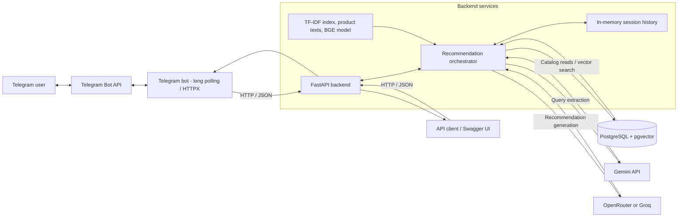
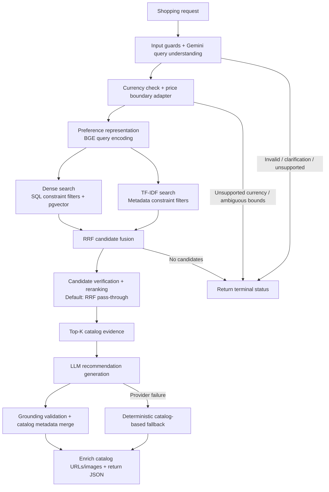

# ShopAssist


Conversational product recommendations with structured query understanding, hybrid retrieval, and evidence-grounded explanations.

[Architecture](#architecture) · [Tech stack](#tech-stack) · [Getting started](#getting-started) · [API usage](#rest-api) · [Learning guides](docs/learning/README.md)

ShopAssist is an educational AI engineering prototype. It turns shopping requests such as **“Puma running shoes under 2000 INR”** into catalog recommendations by combining LLM extraction, explicit constraint filtering, lexical and vector search, and response validation. A FastAPI backend serves both direct API clients and a Telegram bot.

The source dataset contains approximately 20,000 Flipkart products; the prepared catalog contains **8,405 products across 16 categories**, with prices in **Indian rupees (INR)**.

> **Status:** API and Telegram implementations are available. The latest integration evidence (2026-10-15) records successful infrastructure checks and a live recommendation using deterministic fallback. Live user chat validation in Telegram and full provider-backed end-to-end validation remain pending. Docker deployment is planned. See the [development status](docs/development_status.md) for evidence and remaining gates.

## Contents

- [Features and current status](#features-and-current-status)
- [Architecture](#architecture)
- [Tech stack](#tech-stack)
- [Getting started](#getting-started)
- [Usage](#usage)
- [Testing](#testing)
- [Evaluation and limitations](#evaluation-and-limitations)
- [Project structure](#project-structure)
- [Documentation and roadmap](#documentation-and-roadmap)

## Features and current status

| Capability | Current behavior |
| --- | --- |
| Query understanding | Gemini extracts structured constraints and soft preferences using the runtime v1 schema. E5-B/schema v2 remain experimental. |
| Constraint handling | Category, brand, price, and rating filters; a separate adapter resolves supported strict/inclusive price wording. Ambiguous price boundaries require clarification. |
| Hybrid retrieval | TF-IDF cosine search and BGE dense retrieval through PostgreSQL/pgvector, combined with Reciprocal Rank Fusion (RRF). |
| Reranking | RRF pass-through by default; multi-signal, cross-encoder, and combined modes are configurable. |
| Grounded recommendations | Catalog evidence, product IDs, prices, and citations are checked before returning recommendations. Provider failures can produce a deterministic catalog-based fallback. |
| REST API | Validated requests, health probes, request tracing, stage latency metadata, and bounded in-memory session history. |
| Telegram interface | Private text chats, HTML product cards, catalog links/images, typing indicators, and `/start`, `/help`, `/reset` commands. |
| Evaluation | Versioned AI-Silver benchmark, retrieval/reranking metrics, and LLM-as-a-Judge tooling. Silver judgments are AI-generated, not human gold labels. |

## Architecture

### System overview



The bot handles presentation and calls the API; database access and AI orchestration belong to the backend. Session history is stored for tracking, but is not currently used to reformulate follow-up questions.

### Recommendation pipeline



The branches describe retrieval inputs; the implementation currently executes the dense database lookup before lexical search. Other stage failures also return terminal statuses. With no soft preferences, retrieval encodes the base semantic query. See [architecture details and the Telegram sequence diagram](docs/architecture.md) for contracts, failure paths, and source links.

## Tech stack

| Layer | Technology |
| --- | --- |
| Language and API | Python 3.10+, FastAPI, Pydantic v2, Uvicorn |
| Telegram and HTTP | `python-telegram-bot`, HTTPX |
| Query understanding | Google Gen AI SDK / Gemini |
| Embeddings | `BAAI/bge-small-en-v1.5`, 384 dimensions, Sentence Transformers / PyTorch |
| Search and storage | scikit-learn TF-IDF, PostgreSQL + pgvector, SQLAlchemy / psycopg |
| Optional neural reranking | `cross-encoder/ms-marco-MiniLM-L2-v2` |
| Recommendation generation | OpenRouter (default) or Groq |
| Data and tests | pandas, PyArrow/Parquet, pytest |

Dependencies are declared in [pyproject.toml](pyproject.toml). Model names below describe repository defaults, not guarantees of upstream availability.

## Getting started

### 1. Install the local environment

Run commands from the repository root. Use Python 3.10 or newer and a PostgreSQL database with pgvector (the project uses Supabase). Model downloads and live LLM/Telegram calls require internet access. CPU inference is supported; a GPU is optional.

```powershell
python -m venv .venv
.\.venv\Scripts\Activate.ps1
python -m pip install --upgrade pip
python -m pip install -e .
python -m pip install uvicorn pytest
```

On Linux/macOS, replace the activation command with `source .venv/bin/activate`. If PowerShell blocks activation, use `.\.venv\Scripts\python.exe` in place of `python` for subsequent commands.

Uvicorn and pytest are installed explicitly because they are not declared as direct project dependencies. Saved TF-IDF artifacts may require the scikit-learn version used to build them; rebuild the index when changing versions. For the recorded Windows dependency constraints, see the [Phase 13 runtime notes](docs/phase13_runtime.md); that environment record predates the API/bot additions.

### 2. Configure the environment

Copy [.env.example](.env.example) to `.env` if you do not already have a local configuration, then replace its placeholders. Keep credentials out of version control.

| Variable | Purpose / repository default |
| --- | --- |
| `SUPABASE_DB_URL` | PostgreSQL connection URL for the catalog and pgvector search |
| `GEMINI_API_KEY` | Query understanding credentials |
| `GEMINI_MODEL` | `gemini-3.1-flash-lite` |
| `PHASE12_LLM_PROVIDER` | `openrouter` by default; `groq` is also supported |
| `PHASE12_LLM_MODEL` | `google/gemma-4-26b-a4b-it:free` for the default OpenRouter route |
| `OPENROUTER_API_KEY` / `GROQ_API_KEY` | Credentials for the selected recommendation provider |
| `API_HOST` / `API_PORT` | `127.0.0.1` / `8000` |
| `API_RERANKING_METHOD` | `RRF`; alternatives: `MULTI_SIGNAL`, `CROSS_ENCODER`, `COMBINED` |
| `TELEGRAM_BOT_TOKEN` | Needed only when running the bot |
| `SHOPASSIST_API_URL` | Bot backend URL; default `http://127.0.0.1:8000` |

When switching providers, set a compatible `PHASE12_LLM_MODEL` too. The template contains further token, timeout, and session settings. Backend and bot request timeouts default to 90 and 95 seconds respectively.

### 3. Prepare the catalog and search assets

If you already have the prepared catalog, populated database, and matching TF-IDF index, continue to startup. Otherwise, these commands reproduce the data pipeline from the source CSV:

```powershell
python scripts/download_dataset.py
python scripts/select_categories.py
python scripts/clean_dataset.py
python scripts/generate_product_embeddings.py
python scripts/build_tfidf_baseline.py
```

Embedding generation constructs canonical `retrieval_text` when absent and writes `data/processed/products.parquet`. It may download the BGE model on first use. The TF-IDF builder writes `data/processed/tfidf/`.

Provision and load your configured project database, then create the search indexes. These commands create schema/index objects and write catalog rows:

```powershell
python scripts/provision_supabase.py
python scripts/ingest_products.py
python scripts/create_product_indexes.py
python scripts/validate_product_knowledge_base.py
```

The backend expects the Parquet catalog, fitted TF-IDF artifacts, BGE model access/cache, and populated `public.products` table to describe the same catalog. See [embedding generation](docs/phase5_5_batch_embedding_generation.md), [database provisioning](docs/phase5_4_supabase_provisioning.md), and [ingestion](docs/phase5_6_database_ingestion.md) for validation and recovery details.

### 4. Start the backend and bot

In terminal 1, with the environment active:

```powershell
python -m shopassist.api.main
```

Open [Swagger UI](http://127.0.0.1:8000/docs). Probe readiness with:

```powershell
Invoke-RestMethod http://127.0.0.1:8000/api/v1/health
```

Readiness reports database/local component state and provider configuration. A healthy response does not establish live LLM availability or recommendation quality. `/api/v1/health/live` is a lightweight process liveness probe.

For Telegram, activate the same environment in terminal 2 and run:

```powershell
python -m shopassist.bot.main
```

The bot uses long polling and does not need a public webhook URL. Run one polling process per bot token.

## Usage

### REST API

```powershell
$payload = @{
    query = "Puma running shoes under 2000 INR"
    top_k = 3
    language = "en"
    session_id = "demo-session"
} | ConvertTo-Json

Invoke-RestMethod -Method Post `
    -Uri http://127.0.0.1:8000/api/v1/recommend `
    -ContentType "application/json" -Body $payload
```

Requests accept `query` (1–500 characters), `top_k` (1–20), `language` (`auto`, `en`, `vi`), and an optional `session_id`. Responses contain `request_id`, `status`, `overview`, `products`, `metadata`, and `usage`. Product entries can include catalog URLs, images, and cited evidence.

| Endpoint | Purpose |
| --- | --- |
| `POST /api/v1/recommend` | Recommendations; `/recommend` is a compatibility alias |
| `GET /api/v1/health` | Component readiness and configuration indicators |
| `GET /api/v1/health/live` | Process liveness |
| `GET /docs` | Interactive API documentation |

Inspect the business `status` even after HTTP 200: it can indicate `SUCCESS`, `DETERMINISTIC_FALLBACK`, `CLARIFICATION_REQUIRED`, `NO_RESULTS`, or an unsupported/failed request. Request schema errors return HTTP 422; pipeline deadlines can return HTTP 504. See the [API contract](docs/phase15_api_contract.md) and [current response schemas](src/shopassist/api/schemas.py).

### Telegram and CLI

In a private chat with your configured bot, use `/start`, `/help`, or `/reset`, then send a self-contained shopping request such as `Puma running shoes under 2000 INR`. `/reset` rotates the session ID; it does not delete previous backend history immediately.

For individual components:

```powershell
python scripts/search_tfidf.py --query "wireless bluetooth keyboard" --top-k 5
python scripts/search_semantic.py --query "running shoes" --top-k 5
python scripts/parse_user_query.py --query "Puma running shoes under 2000 INR" --json
```

TF-IDF search uses local artifacts; semantic search also needs the database and model; query parsing calls Gemini.

## Testing

Run the API and bot unit/mocked integration suites without live provider calls:

```powershell
python -m pytest tests/test_api_config_and_schemas.py tests/test_api_integration_mocked.py tests/test_api_orchestrator.py tests/test_api_price_adapter.py tests/test_api_session.py tests/test_bot_application.py tests/test_bot_client.py tests/test_bot_commands.py tests/test_bot_config.py tests/test_bot_formatters.py tests/test_bot_integration_mocked.py tests/test_bot_messages.py tests/test_bot_sessions.py -q
```

The [2026-10-15 integration report](docs/phase16_integration_report.md) records **150 passing API/bot tests** (92 API, 58 bot). This is a historical scoped result, not a current full-repository test count.

The full suite is `python -m pytest`. Review integration requirements before running it: Gemini tests can call the API when credentials are configured, some tests load local neural checkpoints, and additional live tests require explicit opt-in flags such as `SHOPASSIST_PHASE15_LIVE_TEST=1`, `SHOPASSIST_PHASE12_LIVE_OPENROUTER=1`, `SHOPASSIST_PHASE12_LIVE_GROQ=1`, or `SHOPASSIST_PHASE11_LIVE_DB=1`. The `integration` and `live_api` markers alone do not cover every opt-in live module.

## Evaluation and limitations

The [Phase 14 evaluation report](docs/phase14_evaluation_report.md) records **Hybrid RRF mean nDCG@5 = 0.9067 across 174 retrieval pools** from the frozen AI-Silver v4 benchmark. This is a retrieval result against AI-generated relevance judgments; it is not human-verified end-to-end recommendation accuracy or a general quality guarantee.

- **Runtime versus experiments:** query understanding uses schema v1. E5-B/schema v2 have not replaced it. The historical 98% extraction exact match omitted preferences; the corrected shared-field exact match was 54% on the original 50 cases. See the [Phase 8.2 audit](docs/phase8_2/final_engineering_report.md).
- **Catalog scope:** prices are INR. The dataset is a static snapshot; product links, images, prices, and availability may differ from current storefronts. Currency conversion is not implemented.
- **Conversation and language:** session history is ephemeral and is not used for contextual follow-up reformulation. The API accepts English/Vietnamese queries and language preferences, but the catalog and BGE model are English-oriented; broad Vietnamese retrieval quality is not established.
- **Unsupported semantics:** exclusion requests and unresolved price boundaries can stop the pipeline. Grounding checks reduce specific errors; they do not prove that every explanation is semantically correct.
- **Provider availability:** generation fallback handles recommendation-provider failure after candidates exist. It does not replace failed query understanding, embedding, or database retrieval.
- **Deployment:** authentication, client rate limiting, distributed sessions, webhook transport, and container deployment remain future work. The current setup targets trusted local prototyping.

## Project structure

```text
ShopAssist/
|-- src/shopassist/
|   |-- api/              # REST contracts, lifecycle, sessions, orchestration
|   |-- bot/              # Telegram client, commands, product cards
|   |-- llm/              # Query understanding and extraction experiments
|   |-- preferences/      # Soft preference normalization and encoding
|   |-- retrieval/        # TF-IDF, dense search, hybrid RRF
|   |-- reranking/        # Candidate verification and reranking
|   |-- recommendation/   # Evidence, providers, grounding validation
|   |-- evaluation/       # Silver workflows, ranking metrics, LLM judge
|   |-- embeddings/       # BGE inference and batch product encoding
|   |-- data/             # Loading, cleaning, category/text construction
|   |-- db/               # Connections, ingestion, indexes, validation
|   `-- core/             # Shared configuration and paths
|-- scripts/              # Dataset, indexing, CLI and evaluation entry points
|-- tests/                # Unit, mocked, model and live integration tests
|-- database/migrations/  # PostgreSQL schema and migrations
|-- data/                 # Raw, interim, processed and evaluation artifacts
`-- docs/                 # Architecture, contracts, evidence and learning guides
```

## Documentation and roadmap

| Start here | Reference |
| --- | --- |
| Architecture and request sequence | [Architecture](docs/architecture.md) |
| Current status and remaining gates | [Development status](docs/development_status.md) |
| Original project proposal | [Proposal](docs/proposal.md) |
| API setup and contracts | [Backend](docs/phase15_fastapi_backend.md), [API contract](docs/phase15_api_contract.md) |
| Telegram setup and validation evidence | [Bot guide](docs/phase16_telegram_bot.md), [integration report](docs/phase16_integration_report.md) |
| Retrieval and reranking | [Hybrid retrieval](docs/phase10_hybrid_retrieval.md), [reranking](docs/phase11_reranking.md) |
| Grounded generation | [Recommendation service](docs/phase12_recommendation.md) |
| Benchmark and evaluation | [Silver benchmark](docs/phase13_silver_benchmark_report.md), [evaluation report](docs/phase14_evaluation_report.md) |
| Query understanding corrections | [Freeze and handover](docs/phase8_freeze_and_handover.md), [Phase 8.2 decision](docs/phase8_2/final_engineering_report.md) |
| Vietnamese AI engineering curriculum | [Learning index](docs/learning/README.md) |

Next gates are live Telegram user validation, full provider-backed end-to-end validation, and Phase 17 containerization/deployment. Follow-up reformulation, webhook transport, and distributed state are tracked in the [API deferred issues](docs/phase15_deferred_issues.md) and [bot deferred issues](docs/phase16_deferred_issues.md). Phase reports retain historical evidence; use the current development status and linked audits when earlier claims conflict.
