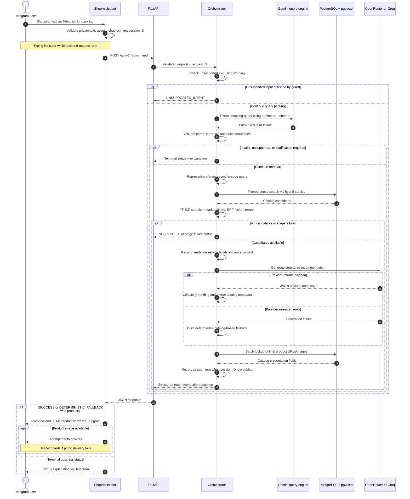

# ShopAssist architecture

This document describes the current API and Telegram implementation. The [README](../README.md#architecture) contains the system overview and recommendation pipeline diagrams. This page adds the request sequence, module responsibilities, and failure boundaries.

Documentation reviewed on **2026-10-23**. Runtime evidence is linked from the [development status](development_status.md); this review does not establish new live validation results.

## Boundaries and responsibilities

| Component | Responsibility | Source |
| --- | --- | --- |
| Telegram adapter | Receive private text updates, maintain chat/session IDs, call the backend, render cards | [Application](../src/shopassist/bot/application.py), [message handler](../src/shopassist/bot/handlers/messages.py), [HTTP client](../src/shopassist/bot/clients/recommendation.py) |
| FastAPI application | Allocate shared resources, validate HTTP payloads, trace requests, enforce pipeline deadlines | [Application lifecycle](../src/shopassist/api/main.py), [route](../src/shopassist/api/routes/recommendations.py), [schemas](../src/shopassist/api/schemas.py) |
| Recommendation orchestrator | Coordinate stages, stop on unsupported/failed inputs, enrich final catalog URLs/images, record session turns | [Orchestrator](../src/shopassist/api/services/orchestrator.py) |
| Query understanding | Extract semantic query, hard constraints, soft preferences, and clarification information with Gemini | [Query engine](../src/shopassist/llm/query_understanding.py), [v1 schema](../src/shopassist/llm/schemas.py) |
| Price boundary adapter | Resolve supported strict/inclusive wording outside the v1 schema | [Adapter](../src/shopassist/api/price_adapter.py) |
| Preference representation | Normalize positive soft preferences and produce a BGE preference query/vector when applicable | [Service](../src/shopassist/preferences/service.py) |
| Hybrid retrieval | Apply constraints to dense and lexical candidates and combine ranks using RRF | [Hybrid service](../src/shopassist/retrieval/hybrid.py) |
| Reranking | Verify candidate contracts and apply the selected strategy; RRF pass-through is the API default | [Reranking service](../src/shopassist/reranking/core.py), [API configuration](../src/shopassist/api/config.py) |
| Grounded generation | Build catalog evidence, call the selected generation provider, validate output, restore authoritative metadata | [Recommendation service](../src/shopassist/recommendation/core.py), [validator](../src/shopassist/recommendation/validation.py) |

The bot has no direct database or AI pipeline access. OpenRouter and Groq are alternative configured generation providers, not an automatic provider failover chain. Gemini serves a separate role: query understanding.

## Telegram request sequence

The diagram groups backend stage services under the orchestrator and omits the Telegram cloud intermediary for readability. Any stage can stop the flow; for example, a preference encoding failure prevents database retrieval. HTTP schema errors (422), request deadlines (504), and transport failures are handled outside this business-status flow. The bot renders backend/connection errors through its error formatter.

## Retrieval and grounding contracts

1. **Extraction is not filtering.** Gemini proposes structured constraints. The API checks currency and independently resolves price operators before retrieval. The v1 extraction schema has no typed exclusions or strict-price flags; schema v2 is experimental.
2. **Both retrieval paths enforce constraints.** Dense retrieval uses parameterized SQL predicates and pgvector cosine distance. TF-IDF cosine results are filtered against candidate metadata. RRF combines the two rank lists; their scores are not assumed to share a scale. The current implementation queries the database before lexical search.
3. **The query vector depends on preferences.** With positive soft preferences, retrieval uses the Phase 9 preference vector. With `NO_PREFERENCES`, the dense encoder embeds the base semantic query. Both use the 384-dimensional BGE embedding space.
4. **Reranking operates on retrieved candidates.** The default RRF mode preserves the fused ranking. Multi-signal, cross-encoder, and combined modes are alternatives; a cross-encoder is not a required step on every request.
5. **Generation receives evidence for selected candidates.** Output validation checks product/evidence references and merges catalog fields. Provider exceptions trigger deterministic fallback. These checks do not establish complete semantic entailment of every generated sentence.
6. **Presentation fields come from the catalog.** The backend looks up final product URLs/images and sanitizes URL schemes. The bot formats and escapes text and can use text cards when external images cannot be delivered.

See the [hybrid contract](phase10_hybrid_retrieval.md), [reranking contract](phase11_reranking_contract.md), and [recommendation contract](phase12_recommendation_contract.md) for stage-level detail.

## Resources, sessions, and deadlines

FastAPI lifespan setup allocates the database engine, TF-IDF index, dense query encoder, canonical product texts, stage services, and session store. The preference service shares the dense encoder. Startup can leave an unfitted TF-IDF index or empty text provider when assets are missing; this does not make recommendations ready.

The orchestrator offloads preference representation and reranking through `asyncio.to_thread`. Remote model calls and database operations use asynchronous interfaces. The hybrid service performs local lexical work within its retrieval call; the diagrams do not imply that all CPU work is independently offloaded or that the two search paths run concurrently.

The API's pipeline deadline is 90 seconds by default. The bot HTTP timeout is 95 seconds, allowing a backend timeout response to arrive first. Both are configurable; independent upstream timeouts/retries can still affect the outcome.

The backend [session store](../src/shopassist/api/session.py) holds bounded conversation history with TTL expiry in process memory. It does not feed history into query extraction. The [bot session manager](../src/shopassist/bot/session.py) maintains per-chat IDs and locks; `/reset` rotates the ID. Multiple workers would have separate state. Contextual follow-up reformulation and distributed sessions remain deferred.

## Failure and readiness boundaries

| Boundary | Current behavior |
| --- | --- |
| Unsupported/ambiguous input | Stop before unsupported constraints enter retrieval; return a business status or request clarification |
| Query understanding unavailable | Stop the pipeline; generation fallback cannot replace query extraction |
| Embedding/database/retrieval failure | Return the relevant failure status; do not generate recommendations from unavailable candidates |
| No matching candidates | Return `NO_RESULTS` |
| Recommendation provider exception | Return catalog-based `DETERMINISTIC_FALLBACK` when valid candidates are available |
| Grounding validation | Validate the payload and merge catalog values; inspect the resulting status rather than assuming generation succeeded |
| External image delivery failure | Fall back to text cards |
| Health probes | Liveness checks the process; readiness checks database/local state and reports provider configuration, without executing live LLM inference |

Historical live evidence is recorded in the [Phase 15 integration report](phase15_integration_report.md) and [Phase 16 integration report](phase16_integration_report.md). The latter records a real fallback recommendation; it does not close the live user chat or full provider-backed validation gates. Deployment improvements are tracked in the [API](phase15_deferred_issues.md) and [bot](phase16_deferred_issues.md) debt registers.
