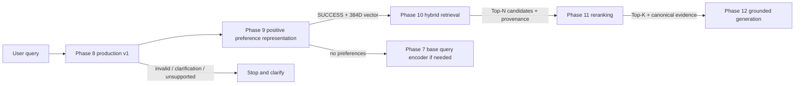

# ShopAssist Development Status and Checklist

**Updated:** 2026-10-13. This is the current roadmap status; prior phase reports remain historical evidence.

| Phase | Current status | Evidence / next gate |
| --- | --- | --- |
| 1–7 | Implemented | Existing phase reports and artifacts; embeddings/model assets retained. |
| 8 | **IMPLEMENTED — ACCEPTED WITH KNOWN LIMITATIONS** | Production remains Gemini `gemini-3.1-flash-lite`, temperature `0.0`, Schema v1. Freeze manifest and debt register created. |
| 8.1 | **EXPERIMENTAL REFINEMENT COMPLETE — NOT FULLY ADOPTED IN PRODUCTION** | E5-B/schema-v2 remain experimental; historical reports preserved. |
| 8.2 | **PARTIAL — RESEARCH AND OFFLINE VALIDATION COMPLETE; LIVE OPTIMIZATION DEFERRED** | 12 investigations reconciled; no deferred 312-call run. |
| 9 | **PASS — COMPONENT SCOPE** | 22/22 Phase 9 tests; 398/398 offline regression tests (Gemini module excluded); 384D BGE validation; 12/12 curated relevant-over-irrelevant paired checks; local CUDA timings. Not an end-to-end recommendation-quality claim. |
| 10 | **PASS — OFFLINE COMPONENT SCOPE** | Phase 10 tests **21/21 passed**; offline regression **405 passed, 14 live/integration tests deselected**. No Phase 10 live DB or catalog-quality evaluation. Phase 8 v1 price bounds require separately verified strict/inclusive metadata; otherwise the query stops as unsupported. See [Phase 10 report](phase10_hybrid_retrieval.md). |
| 11 | **VALIDATED FOR PROTOTYPE — REAL INFERENCE & LIVE INTEGRATION VERIFIED** | Pinned Cross-Encoder downloaded (`1b5cd67b15209f24824c50370e0397743aa9b787`), CPU inference/token truncation/latencies benchmarked, Phase 10 live DB integration verified (53/53 tests pass). RRF remains default; 40-query independent evaluation deferred to Phase 13–14. See [Phase 11 report](phase11_reranking.md). |
| 12 | **VALIDATED FOR PROTOTYPE — OPENROUTER GEMMA 4 MIGRATION & GROUNDING VERIFIED** | OpenRouter migration complete (`google/gemma-4-26b-a4b-it:free` by default, standard route and Groq preserved); live API authentication and JSON schema verified; 100% groundedness pass rate across 7 catalog scenarios; zero cross-product hallucinations; token/latency/cost measured; deterministic fallbacks verified under upstream rate limits; all repository regression tests passing. See [Phase 12 report](phase12_recommendation.md). |
| 13 | **PARTIAL — LIVE AI SMOKE CHECKPOINTED; HUMAN GROUND TRUTH PENDING** | The v1/v2/v3 evidence remains preserved. The supported Windows runtime and PyArrow catalog preflight pass; 34 Phase-13 tests pass. A read-only v3 retrieval smoke ran TF-IDF/dense/hybrid for Q0007, Q0013, and Q0045, while Q0008 correctly stopped on unsupported exclusion intent. The authorised four-query live AI audit in isolated `ai_silver/v2` recorded eight calls: OpenRouter failed all four, Groq completed only Q0013, so no audited pool, relevance label, qrel, or Phase 14 evidence was created. These `data/interim` captures are explicitly unverified diagnostic evidence, not Silver labels. Resume requires explicit inspection of provider errors; no model/provider fallback is permitted. Silver labels can never set Phase 14 ready. See [Phase 13 report](phase13_dataset_report.md) and the [AI-Silver pipeline](phase13_ai_silver_pipeline.md). |
| 14–17 | Not started | System evaluation, API, Telegram and deployment follow roadmap. |

## Current Phase 9 checklist

- [x] Deterministic normalization and stable query composition implemented.
- [x] Typed output statuses and no-preference behavior implemented.
- [x] Phase 8 v1 integration boundary and clarification/error handling implemented.
- [x] Conservative exclusion/currency guard implemented.
- [x] Phase 7 BGE encoder adapter implemented with 384D/finite/unit-norm checks and batch adapter.
- [x] Offline unit and mocked integration tests authored.
- [x] Phase 8 freeze manifest and reconciled technical debt documented.
- [x] Execute Phase 9 tests in the project dependency environment (22/22).
- [x] Execute real BGE model and vector compatibility checks (384D finite normalized outputs).
- [x] Measure paired composition ranking and single/batch performance (four curated cases).
- [x] Run applicable Phase 5–8 offline regression suite (398 passed; Gemini module excluded).
- [ ] Coalesce safe `represent_batch` requests into one embedding batch.

## Current flow

## Phase 10 checklist

- [x] Typed Phase 10 result/status contract with safe stop states.
- [x] Parameterized category, brand and minimum-rating SQL filters; null ratings do not satisfy a threshold.
- [x] Explicit strict/inclusive price operator handling; Phase 8 v1 requests without verified operators stop as unsupported.
- [x] Phase 9 vector model/dimension/finite/nonzero/unit-norm validation and Phase 7 base-query path for `NO_PREFERENCES`.
- [x] Dense pgvector + filtered Phase 6 TF-IDF retrieval with deterministic RRF, de-duplication and provenance.
- [x] Offline component tests and Phase 10 contract documentation.
- [x] Run Phase 10 tests in the project dependency environment (21/21).
- [x] Run offline regression suite (405 passed; 14 live/integration tests deselected; Gemini module excluded).
- [ ] Verify live database behavior and measure retrieval quality on a labeled catalog evaluation set.

## Phase 11 checklist

- [x] Typed Phase 10 → Phase 11 → Phase 12 contracts with candidate-subset invariants.
- [x] Deterministic Phase 10 RRF pass-through baseline and experimental dense/lexical rank utility aggregation.
- [x] Optional batched Sentence Transformers Cross-Encoder adapter; loader uses local files only and CPU; pinned checkpoint installed and benchmarked.
- [x] Resolve canonical Phase 5.2 `retrieval_text` by exact product ID and include it in Phase 12 handoff.
- [x] Fail closed on Phase 10 failures, exclusions, foreign currency, visible constraint violations, duplicate IDs, invalid scores, missing text and model failures.
- [x] Dedicated offline tests and fixed-candidate, four-query catalog relevance evaluation with real Cross-Encoder inference.
- [x] Record method, per-query, quality and warm latency artifacts under `data/interim/phase11/`.
- [x] Verify live Phase 10 / pgvector database integration with authentic retrieval candidates and contract assertions.
- [x] Download pinned checkpoint (`1b5cd67b15209f24824c50370e0397743aa9b787`), measure token truncation across 33,620 pairs, cold start, and CPU batch latencies.
- [ ] 40-query independent double-annotator review, adjudication, and evaluation split (P11-01, deferred to Phase 13–14).
- [ ] Select any combined-model weights only on a development split, followed by a locked evaluation split (P11-04, deferred to Phase 13–14).

## Phase 12 checklist

- [x] Dedicated Groq provider client with `openai/gpt-oss-20b`, JSON Schema Strict Mode, and bounded backoff.
- [x] Provider isolation: `GROQ_API_KEY` and Phase 12 settings completely independent of Phase 8 Gemini configuration.
- [x] Typed Phase 12 contract (`RecommendationResult`, `RecommendedProduct`, `TokenUsage`) with Pydantic v2.
- [x] Evidence Context Builder with `{product_id}-E{counter}` traceable items, boilerplate stripping, and XML boundary protection.
- [x] Grounded prompt engineering supporting bilingual (English / Vietnamese) product explanations.
- [x] Post-generation Groundedness Validator enforcing product ID invariants, ordering preservation, and metadata authority.
- [x] Deterministic metadata fallback on provider or parsing failures.
- [x] Full offline unit test suite (16 tests, 100% passing).
- [x] Live Groq API integration test suite (3 tests, 100% passing).
- [x] Preliminary evaluation on 7 real catalog scenarios with token usage, latency, and cost benchmarking.
- [x] Context builder A/B benchmark demonstrating 18.1% input token reduction.
- [x] Comprehensive documentation (`phase12_recommendation.md`, `phase12_recommendation_contract.md`, `phase12_recommendation_evaluation.md`, `phase12_deferred_issues.md`).
- [ ] Offline NLI entailment scoring model for automated semantic claim verification (P12-01, deferred to Phase 13–14).
- [ ] Token streaming for conversational FastAPI/Telegram interfaces (P12-02, deferred to Phase 15–16).

See [Phase 8 freeze and handover](phase8_freeze_and_handover.md), [Phase 8 technical debt](technical_debt/phase8_deferred_issues.md), [Phase 9 engineering report](phase9_soft_preference_representation.md), [Phase 11 deferred issues](technical_debt/phase11_deferred_issues.md), [Phase 12 report](phase12_recommendation.md), and [Phase 12 deferred issues](technical_debt/phase12_deferred_issues.md).
