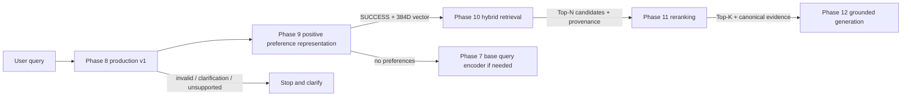

# ShopAssist Development Status and Checklist

**Updated:** 2026-10-13. This is the current roadmap status; prior phase reports remain historical evidence.

| Phase | Current status | Evidence / next gate |
| --- | --- | --- |
| 1–7 | Implemented | Existing phase reports and artifacts; embeddings/model assets retained. |
| 8 | **IMPLEMENTED — ACCEPTED WITH KNOWN LIMITATIONS** | Production remains Gemini `gemini-3.1-flash-lite`, temperature `0.0`, Schema v1. Freeze manifest and debt register created. |
| 8.1 | **EXPERIMENTAL REFINEMENT COMPLETE — NOT FULLY ADOPTED IN PRODUCTION** | E5-B/schema-v2 remain experimental; historical reports preserved. |
| 8.2 | **PARTIAL — RESEARCH AND OFFLINE VALIDATION COMPLETE; LIVE OPTIMIZATION DEFERRED** | 12 investigations reconciled; no deferred 312-call run. |
| 9 | **PASS — COMPONENT SCOPE** | 22/22 Phase 9 tests; 398/398 offline regression tests (Gemini module excluded); 384D BGE validation; 12/12 curated relevant-over-irrelevant paired checks; local CUDA timings. Not an end-to-end recommendation-quality claim. |
| 10 | **PASS — OFFLINE COMPONENT SCOPE** | Phase 10 tests **21/21 passed**; offline regression **405 passed, 14 live/integration tests deselected**. No Phase 10 live DB or catalog-quality evaluation. Phase 8 v1 price bounds require separately verified strict/inclusive metadata; otherwise the query stops as unsupported. See [Phase 10 report](phase10_hybrid_retrieval.md). |
| 11 | **VALIDATED FOR PROTOTYPE — REAL INFERENCE & LIVE INTEGRATION VERIFIED** | Pinned Cross-Encoder downloaded (`1b5cd67b15209f24824c50370e0397743aa9b787`), CPU inference/token truncation/latencies benchmarked, Phase 10 live DB integration verified (53/53 tests pass). RRF remains default; 40-query independent evaluation deferred to Phase 13–14. See [Phase 11 report](phase11_reranking.md). |
| 12 | **VALIDATED FOR PROTOTYPE — OPENROUTER GEMMA 4 MIGRATION & GROUNDING VERIFIED** | OpenRouter migration complete (`google/gemma-4-26b-a4b-it:free` by default, standard route and Groq preserved); live API authentication and JSON schema verified; 100% groundedness pass rate across 7 catalog scenarios; zero cross-product hallucinations; token/latency/cost measured; deterministic fallbacks verified under upstream rate limits; all repository regression tests passing. See [Phase 12 report](phase12_recommendation.md). |
| 14 | **AI ENGINEERING EXPERIMENTAL EVALUATION COMPLETE — EDUCATIONAL SCOPE** | AI-Silver v4 validated (0 errors, 0 warnings); Baseline Retrieval (TF-IDF, Dense, Hybrid RRF) evaluated across All (174 pools), Dev (140), and Held-Out (60); Hybrid achieves nDCG@5 = 0.9067; Phase 11 Reranking (RRF vs Multi-Signal vs CPU Cross-Encoder) benchmarked; RAG Trace Q0001 generated; LLM-as-a-Judge rubric & live Gemini execution verified (Decision=PASS, Groundedness=4/5); 11/11 Phase 14 unit tests passed; Comprehensive 10-lesson Vietnamese AI Engineering curriculum authored in `docs/learning/`. Human Gold evaluation explicitly superseded by educational scope. `phase14_learning_status = COMPLETE`. See [Phase 14 Evaluation Report](phase14_evaluation_report.md). |
| 15 | **IMPLEMENTED — PENDING LIVE THIRD-PARTY VALIDATION** | FastAPI backend implemented under `src/shopassist/api/`; lifespan resource management; PriceBoundaryAdapter (48 bilingual scenarios); RecommendationOrchestrator coordinating Phases 8–12 with short-circuiting; 91/91 Phase 15 unit and mocked integration tests passed; 610/610 full offline regression tests passed; live health probe verified against Supabase PostgreSQL and BGE embeddings; external live validation pending Google Gemini 503 and OpenRouter 429 quota resolution. See [Phase 15 report](phase15_fastapi_backend.md). |
| 16–17 | Planned | Telegram Chatbot and Docker deployment follow roadmap. |

## Current Phase 15 checklist

- [x] Application architecture and packaging designed under `src/shopassist/api/`.
- [x] Lifespan resource manager allocating shared SQLAlchemy AsyncEngine, TF-IDF index, BGE embedding model, and canonical texts.
- [x] Strongly-typed Pydantic v2 schemas for request validation, product response, metadata, and usage telemetry (`RecommendationRequest`, `RecommendationResponse`).
- [x] Narrowly-scoped bilingual PriceBoundaryAdapter resolving strict (<, >) vs inclusive (<=, >=) operators across 48 test scenarios.
- [x] RecommendationOrchestrator coordinating Phases 8–12 with comprehensive short-circuiting on invalid inputs, clarifications, currency mismatches, and exclusions.
- [x] Threadpool execution (`asyncio.to_thread`) for CPU-bound tasks (BGE encoding, TF-IDF dot products, RRF reranking) to prevent event loop blocking.
- [x] Primary endpoint `POST /api/v1/recommend` and backward-compatible alias `POST /recommend`.
- [x] Health probe `GET /api/v1/health` and liveness probe `GET /api/v1/health/live`.
- [x] Ephemeral in-memory conversation session store with TTL bounding for Phase 16 Telegram preparation.
- [x] Global exception handlers sanitizing errors and protecting credentials.
- [x] Full unit test suite (74 tests, 100% passing).
- [x] Mocked HTTP API integration suite (16 tests, 100% passing).
- [x] Full offline regression suite (610 tests passed, 0 failures).
- [x] Real infrastructure smoke test verifying live PostgreSQL 17.11 Supabase connection and local assets.
- [x] Comprehensive documentation authored (`phase15_fastapi_backend.md`, `phase15_api_contract.md`, `phase15_integration_report.md`, `phase15_deferred_issues.md`, `phase15_preimplementation_audit.md`).
- [x] Vietnamese AI Engineering curriculum updated with Lesson 11 (`docs/learning/11_fastapi_backend_and_ai_orchestration.md`).
- [ ] Live external third-party end-to-end smoke test pending Google Gemini (503) and OpenRouter (429) quota clearance.

## Current Phase 14 checklist

- [x] Validate immutable AI-Silver v4 benchmark (`data/evaluation/phase13/ai_silver/v4_full_silver/`): PASS (0 errors, 0 warnings).
- [x] Implement mathematically rigorous ranking metrics with rank preservation, pool universe IDCG, and incomplete judgment handling (`src/shopassist/evaluation/phase14_metrics.py`).
- [x] Baseline retrieval evaluation: TF-IDF, Dense, and Hybrid RRF across All (174 pools), Development (140), and Held-Out (60) splits.
- [x] Reranking evaluation: benchmark RRF Pass-through, Multi-Signal, and pinned CPU Cross-Encoder (`ms-marco-MiniLM-L2-v2`).
- [x] Structured retrieval analysis: verify 100% hard constraint satisfaction rate using SQL pre-filtering in pgvector.
- [x] Traceable RAG pipeline demonstration (Q0001): end-to-end provenance across Phase 8 -> 9 -> 10 -> 11 -> 12.
- [x] LLM-as-a-Judge evaluation framework: 5-criteria rubric, deterministic validation separation, structured Pydantic JSON schema.
- [x] Live LLM Judge execution verified using `gemini-3.1-flash-lite` (Decision=PASS, Groundedness=4/5).
- [x] Comprehensive unit tests authored: 11/11 passed with 100% coverage of metrics, constraints, RAG trace, and judge.
- [x] Versioned machine-readable artifacts and SHA-256 manifest exported under `data/evaluation/phase14/v1/`.
- [x] Comprehensive evaluation report authored under `docs/phase14_evaluation_report.md`.
- [x] Complete 10-lesson Vietnamese AI Engineering learning curriculum authored under `docs/learning/`.
- [x] Set official educational status: `phase14_learning_status = COMPLETE`.

## Current Phase 9 checklist

- [x] Deterministic normalization and stable query composition implemented.
- [x] Typed output statuses and no-preference behavior implemented.
- [x] Phase 8 v1 integration boundary and clarification/error handling implemented.
- [x] Conservative exclusion/currency guard implemented.
- [x] Phase 7 BGE encoder adapter implemented with 384D/finite/unit-norm checks and batch adapter.
- [x] Offline unit and mocked integration tests authored.
- [x] Phase 8 freeze manifest and reconciled technical debt documented.
- [x] Execute Phase 9 tests in the project dependency environment (22/22).
- [x] Execute real BGE model and vector compatibility checks (384D finite normalized outputs).
- [x] Measure paired composition ranking and single/batch performance (four curated cases).
- [x] Run applicable Phase 5–8 offline regression suite (398 passed; Gemini module excluded).
- [ ] Coalesce safe `represent_batch` requests into one embedding batch.

## Current flow

## Phase 10 checklist

- [x] Typed Phase 10 result/status contract with safe stop states.
- [x] Parameterized category, brand and minimum-rating SQL filters; null ratings do not satisfy a threshold.
- [x] Explicit strict/inclusive price operator handling; Phase 8 v1 requests without verified operators stop as unsupported.
- [x] Phase 9 vector model/dimension/finite/nonzero/unit-norm validation and Phase 7 base-query path for `NO_PREFERENCES`.
- [x] Dense pgvector + filtered Phase 6 TF-IDF retrieval with deterministic RRF, de-duplication and provenance.
- [x] Offline component tests and Phase 10 contract documentation.
- [x] Run Phase 10 tests in the project dependency environment (21/21).
- [x] Run offline regression suite (405 passed; 14 live/integration tests deselected; Gemini module excluded).
- [ ] Verify live database behavior and measure retrieval quality on a labeled catalog evaluation set.

## Phase 11 checklist

- [x] Typed Phase 10 → Phase 11 → Phase 12 contracts with candidate-subset invariants.
- [x] Deterministic Phase 10 RRF pass-through baseline and experimental dense/lexical rank utility aggregation.
- [x] Optional batched Sentence Transformers Cross-Encoder adapter; loader uses local files only and CPU; pinned checkpoint installed and benchmarked.
- [x] Resolve canonical Phase 5.2 `retrieval_text` by exact product ID and include it in Phase 12 handoff.
- [x] Fail closed on Phase 10 failures, exclusions, foreign currency, visible constraint violations, duplicate IDs, invalid scores, missing text and model failures.
- [x] Dedicated offline tests and fixed-candidate, four-query catalog relevance evaluation with real Cross-Encoder inference.
- [x] Record method, per-query, quality and warm latency artifacts under `data/interim/phase11/`.
- [x] Verify live Phase 10 / pgvector database integration with authentic retrieval candidates and contract assertions.
- [x] Download pinned checkpoint (`1b5cd67b15209f24824c50370e0397743aa9b787`), measure token truncation across 33,620 pairs, cold start, and CPU batch latencies.
- [ ] 40-query independent double-annotator review, adjudication, and evaluation split (P11-01, deferred to Phase 13–14).
- [ ] Select any combined-model weights only on a development split, followed by a locked evaluation split (P11-04, deferred to Phase 13–14).

## Phase 12 checklist

- [x] Dedicated Groq provider client with `openai/gpt-oss-20b`, JSON Schema Strict Mode, and bounded backoff.
- [x] Provider isolation: `GROQ_API_KEY` and Phase 12 settings completely independent of Phase 8 Gemini configuration.
- [x] Typed Phase 12 contract (`RecommendationResult`, `RecommendedProduct`, `TokenUsage`) with Pydantic v2.
- [x] Evidence Context Builder with `{product_id}-E{counter}` traceable items, boilerplate stripping, and XML boundary protection.
- [x] Grounded prompt engineering supporting bilingual (English / Vietnamese) product explanations.
- [x] Post-generation Groundedness Validator enforcing product ID invariants, ordering preservation, and metadata authority.
- [x] Deterministic metadata fallback on provider or parsing failures.
- [x] Full offline unit test suite (16 tests, 100% passing).
- [x] Live Groq API integration test suite (3 tests, 100% passing).
- [x] Preliminary evaluation on 7 real catalog scenarios with token usage, latency, and cost benchmarking.
- [x] Context builder A/B benchmark demonstrating 18.1% input token reduction.
- [x] Comprehensive documentation (`phase12_recommendation.md`, `phase12_recommendation_contract.md`, `phase12_recommendation_evaluation.md`, `phase12_deferred_issues.md`).
- [ ] Offline NLI entailment scoring model for automated semantic claim verification (P12-01, deferred to Phase 13–14).
- [ ] Token streaming for conversational FastAPI/Telegram interfaces (P12-02, deferred to Phase 15–16).

## Phase 13 checklist

- [x] Investigate and fix metadata inconsistency between `dataset_manifest.json` and `validation_report_silver.json` (`silver_ready` synchronization).
- [x] Add regression test detecting silent metadata disagreement (`test_metadata_consistency_and_silent_disagreement_detection`).
- [x] Author comprehensive Stage A Pilot Quality Audit report (`docs/phase13_pilot_quality_audit.md`).
- [x] Execute independent dual-agent query understanding audits across all 200 queries (200 Judge A, 200 Judge B, 200 adjudications, 0 unresolved).
- [x] Capture and freeze multi-method candidate pools (TF-IDF, dense pgvector, hybrid at contribution depth 10; 174 pools, 522 runs, 2,400 candidate pairs, 26 documented blockers).
- [x] Optimize async DB connection pooling and TF-IDF caching in `silver.py` to prevent connection thrashing and socket exhaustion.
- [x] Execute blinded dual-agent relevance judging (2,400 Judge A, 2,400 Judge B) adhering strictly to Phase 13 rubric.
- [x] Adjudicate all 355 substantive disagreements with evidence-grounded rationales; enforce hard-constraint capping invariant.
- [x] Generate versioned Silver qrels (`qrels_silver.csv`: 2,400 rows; 144 Grade 3, 847 Grade 2, 1,389 Grade 1, 20 Grade 0).
- [x] Generate inter-judge agreement report (`agreement_report.json`: 85.21% exact agreement, quadratic kappa 0.8336).
- [x] Audit Phase 12 generation assets; truthfully record generation component as blocked by 50 missing authentic interaction snapshots (`generation_silver_complete = false`).
- [x] Export blinded 40-pair stratified human calibration sample (`human_calibration_sample.jsonl`, status `PENDING`).
- [x] Deterministically freeze 70/30 development/held-out split with zero partition leakage (`splits.json`: 140 dev, 60 held-out).
- [x] Validate immutable benchmark release `data/evaluation/phase13/ai_silver/v4_full_silver/` (0 errors, 0 warnings, `silver_ready = true`).
- [x] Maintain scientific integrity: `label_quality = SILVER`, `human_verified = false`, `phase14_ready = false`.
- [x] Run full offline regression test suite (524 tests passed, 23 Phase 13 tests passed, 0 failures).
- [x] Author comprehensive benchmark documentation (`docs/phase13_silver_benchmark_report.md`).
- [ ] Capture 50 authentic Phase 12 recommendation interaction transcripts when production API is authorized (unblocks `generation_silver_complete`).
- [ ] Complete human calibration review on 40-pair sample (P13-HUMAN-CALIB).

See [Phase 8 freeze and handover](phase8_freeze_and_handover.md), [Phase 8 technical debt](technical_debt/phase8_deferred_issues.md), [Phase 9 engineering report](phase9_soft_preference_representation.md), [Phase 11 deferred issues](technical_debt/phase11_deferred_issues.md), [Phase 12 report](phase12_recommendation.md), [Phase 12 deferred issues](technical_debt/phase12_deferred_issues.md), [Phase 13 Pilot Audit](phase13_pilot_quality_audit.md), and [Phase 13 Silver Benchmark Report](phase13_silver_benchmark_report.md).

