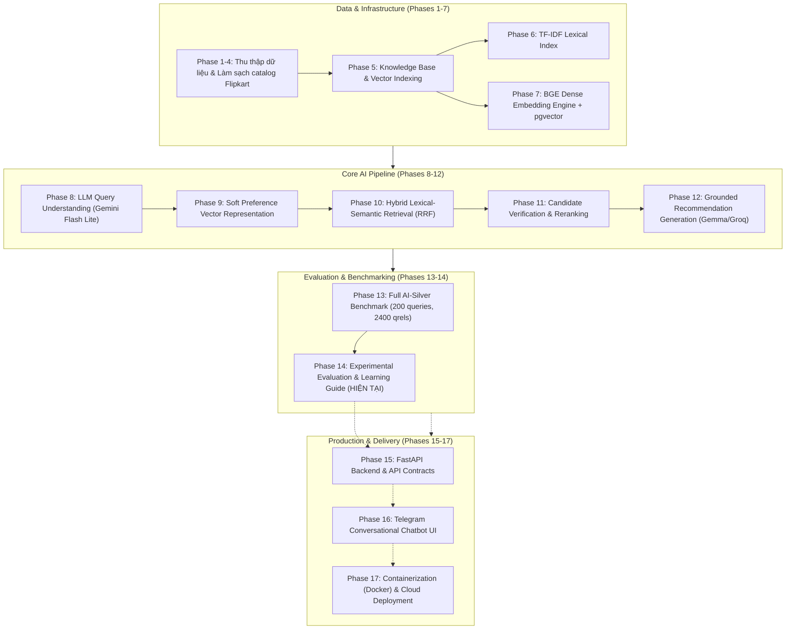

# Bài 00 — Lộ Trình AI Engineering & Vị Trí Của ShopAssist

---

## 1. AI Engineer Là Gì? Khác Gì Với Software Engineer & Data Scientist?

Trong kỷ nguyên của các mô hình nền tảng (Foundation Models như GPT-4, Gemini, Claude, LLaMA), ranh giới giữa việc huấn luyện mô hình và xây dựng sản phẩm phần mềm đã thay đổi hoàn toàn:

| Tiêu chí | Machine Learning / Data Scientist | Traditional Software Engineer (SWE) | AI Engineer |
|---|---|---|---|
| **Trọng tâm chính** | Huấn luyện mô hình từ đầu, tối ưu hóa hàm mất mát (Loss), toán học thống kê. | Xây dựng logic nghiệp vụ, backend, frontend, cơ sở dữ liệu, APIs, độ tin cậy của phần mềm. | **Tích hợp mô hình AI vào phần mềm thực tế**, xây dựng hệ thống RAG, prompt engineering, đánh giá và kiểm soát độ tin cậy. |
| **Đầu ra (Artifact)** | File trọng số mô hình (Weights), Jupyter Notebook, bài báo khoa học. | Ứng dụng web, microservices, cơ sở dữ liệu quan hệ. | **Hệ thống AI chạy production:** AI Agent, RAG Pipeline, Vector Database, Evaluator tự động. |
| **Cách tư duy** | Xác suất thống kê, kiểm định giả thuyết. | Tính tất định (Deterministic), cấu trúc dữ liệu, thuật toán chuẩn. | **Kết hợp cả hai:** Bọc lớp tất định (Deterministic Guardrails) quanh thành phần bất định (Non-deterministic LLM). |

> **Định nghĩa cô đọng:**  
> **AI Engineer** là kỹ sư phần mềm biết cách sử dụng các mô hình AI/LLM như những "linh kiện tính toán" có khả năng nhận thức, kết hợp chúng với cơ sở dữ liệu, logic nghiệp vụ và các lớp bảo vệ kiểm định để tạo ra sản phẩm thông minh, tin cậy và có giá trị thương mại.

---

## 2. Vị Trí Của ShopAssist Trong Bức Tranh AI Engineering

Dự án **ShopAssist** là một đồ án mẫu mực (Reference Project) chuẩn mực của một AI Engineer:
- **Không phải đồ án ML truyền thống:** Chúng ta không train một mạng CNN hay Transformer từ con số 0.
- **Không phải ứng dụng gọi API đơn giản (Wrapper):** Chúng ta không chỉ nhận câu hỏi rồi gửi thẳng cho ChatGPT qua một prompt thô sơ.
- **ShopAssist là một hệ thống AI đa tầng (Multi-Stage AI System):**
  1. *Lớp hiểu ý định (Intent Understanding):* Dùng LLM trích xuất thuộc tính cấu trúc (JSON Schema).
  2. *Lớp biểu diễn sở thích (Preference Representation):* Dùng mô hình Embedding chuyển văn bản thành vector toán học.
  3. *Lớp tìm kiếm lai (Hybrid Retrieval):* Kết hợp tìm kiếm từ khóa (TF-IDF) và tìm kiếm ngữ nghĩa (pgvector HNSW) có lọc điều kiện SQL (Structured Filters).
  4. *Lớp tái xếp hạng (Reranking):* Dùng mô hình Cross-Encoder và thuật toán đa tín hiệu (Multi-Signal).
  5. *Lớp sinh đề xuất có kiểm soát (Grounded Generation):* Chỉ cho phép LLM giải thích dựa trên các bằng chứng sản phẩm có thực trong catalog, chống ảo giác (Hallucination).
  6. *Lớp đánh giá tự động (Evaluation):* Dùng AI-Silver Benchmark và LLM-as-a-Judge để đo lường định lượng nDCG, MRR, Precision.

---

## 3. Lộ Trình 17 Phase Của Dự Án ShopAssist

Toàn bộ vòng đời phát triển dự án được chia thành 17 Phase nối tiếp nhau một cách khoa học:

### Chi tiết trạng thái hiện tại:
- **Phase 1–7 (Hoàn thành):** Xử lý 8,405 sản phẩm, tạo trường `retrieval_text` chuẩn hóa, dựng cơ sở dữ liệu Supabase PostgreSQL với extension `pgvector` và index HNSW.
- **Phase 8 (Hoàn thành):** Dùng `gemini-3.1-flash-lite` với nhiệt độ `0.0` để phân tích truy vấn người dùng thành JSON gồm: `semantic_query`, `hard_constraints` (danh mục, hãng, khoảng giá, đánh giá sao), `soft_preferences`.
- **Phase 9 (Hoàn thành):** Biểu diễn các sở thích mềm thành vector 384 chiều chuẩn hóa L2 qua mô hình BGE.
- **Phase 10 (Hoàn thành):** Thực thi Hybrid Retrieval với thuật toán Reciprocal Rank Fusion (RRF), kết hợp tìm kiếm SQL có điều kiện cứng và tìm kiếm cosine distance.
- **Phase 11 (Hoàn thành):** Nghiên cứu tái xếp hạng với Multi-Signal và Cross-Encoder (`ms-marco-MiniLM-L2-v2`).
- **Phase 12 (Hoàn thành):** Xây dựng ngữ cảnh chứng cứ (`[PID-E#]`), sinh đề xuất mua sắm có trích dẫn nguồn bằng JSON Schema nghiêm ngặt.
- **Phase 13 (Hoàn thành):** Đóng băng bộ benchmark 200 truy vấn `v4_full_silver` gồm 174 pool, 522 retrieval runs, 2,400 nhãn Silver được 2 AI Judges duyệt độc lập và phân xử đồng thuận.
- **Phase 14 (ĐANG THỰC HIỆN — HOÀN TẤT):** Đánh giá thực nghiệm toàn diện các phương pháp retrieval/reranking, triển khai workflow LLM-as-a-Judge, đo lường các trade-off kỹ thuật và hoàn thiện bộ tài liệu học tập tiếng Việt.

---

## 4. Tại Sao Dự Án Chuyển Hướng Sang "Learning-Oriented"?

Ban đầu, quy trình phát triển truyền thống yêu cầu phải có chuyên viên con người gán nhãn thủ công (Human Gold Ground Truth) trước khi hoàn tất Phase 14. Tuy nhiên:
1. **Mục tiêu thực tế:** Dự án này là đồ án tự học và làm chủ kỹ thuật AI Engineering. Việc thuê người gán nhãn hàng nghìn cặp sản phẩm tốn kém thời gian và chi phí mà không gia tăng thêm kiến thức kỹ thuật về cách xây dựng hệ thống RAG.
2. **Giải pháp AI Engineering hiện đại:** Ngành công nghiệp AI hiện nay đang ứng dụng mạnh mẽ phương pháp **AI-Assisted Evaluation** (AI-Silver + Deterministic Validation + LLM-as-a-Judge). Phương pháp này giúp nhà phát triển lặp nhanh (fast iteration), đo lường sự suy thoái chất lượng (regression testing) tự động mà không bị nghẽn (block) bởi việc gán nhãn thủ công.

---

## 5. Mã Nguồn Tham Chiếu
- [docs/development_status.md](file:///d:/Project/ShopAssist/docs/development_status.md): Toàn bộ trạng thái phát triển và checklist qua từng Phase.
- [docs/proposal.md](file:///d:/Project/ShopAssist/docs/proposal.md): Bản đề xuất thiết kế ban đầu của dự án.
- [src/shopassist/evaluation/](file:///d:/Project/ShopAssist/src/shopassist/evaluation/): Gói mã nguồn đánh giá hệ thống.

---

## 6. Bài Học Cốt Lõi (Key Takeaways)
1. **AI Engineering là kỹ thuật tích hợp và kiểm soát:** Không phải cứ huấn luyện mô hình mới là làm AI; việc ghép nối các mô hình vào một kiến trúc tin cậy, chi phí thấp, phản hồi nhanh mới là thách thức lớn nhất.
2. **Deterministic bao bọc Stochastic:** Mô hình ngôn ngữ vốn ngẫu nhiên; hệ thống kỹ thuật tốt là hệ thống dùng code tất định (SQL, Pydantic, rule checks) để kiểm soát đầu vào và đầu ra của LLM.
3. **Đánh giá là cốt lõi:** Nếu không đo lường được bằng số (Metrics), bạn sẽ không thể biết được thay đổi trong prompt hoặc thay đổi trong model có thực sự làm sản phẩm tốt lên hay không.
