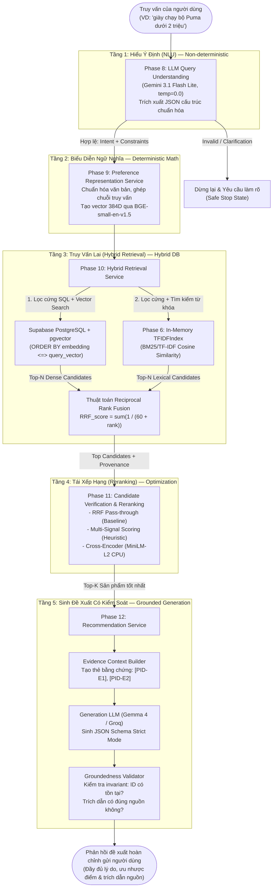

# Bài 01 — Kiến Trúc Tổng Thể ShopAssist & Luồng Dữ Liệu

---

## 1. Khái Niệm Cốt Lõi: Kiến Trúc Phân Lớp Đa Tầng (Multi-Tier Pipeline)

Một trong những sai lầm phổ biến nhất của người mới xây dựng ứng dụng AI là đưa thẳng toàn bộ dữ liệu vào một prompt duy nhất và yêu cầu LLM "Hãy tìm sản phẩm phù hợp và trả lời khách hàng". Cách làm ngây thơ này gặp phải 3 vấn đề chí mạng:
1. **Chi phí token bùng nổ:** Catalog hàng nghìn sản phẩm sẽ làm tràn context window của LLM.
2. **Ảo giác (Hallucination):** LLM tự bịa ra sản phẩm, sai giá tiền hoặc sai thông số kỹ thuật.
3. **Không thể lọc chính xác (Hard Constraints):** LLM không giỏi so sánh số học (ví dụ: tìm sản phẩm có giá chính xác dưới 1,500,000 VND).

Để giải quyết triệt để, **ShopAssist** được thiết kế theo mô hình kiến trúc phân lớp (Multi-tier Pipeline):
- **Tách biệt thành phần Nhận thức (Perception) và Hành động (Action):** Dùng LLM ở đầu vào để hiểu ngôn ngữ tự nhiên, sau đó chuyển giao cho cơ sở dữ liệu và thuật toán toán học xử lý tìm kiếm, rồi mới dùng LLM ở đầu ra để diễn giải đề xuất.
- **Tách biệt Deterministic (Tất định) và Non-Deterministic (Bất định):** Những tác vụ cần độ chính xác 100% như kiểm tra khoảng giá, kiểm tra danh mục được giao cho SQL Database. Những tác vụ cần suy luận ngữ nghĩa mềm mại được giao cho Vector Search và LLM.

---

## 2. Sơ Đồ Kiến Trúc Hệ Thống (System Architecture Diagram)

Dưới đây là sơ đồ Mermaid thể hiện toàn bộ luồng dữ liệu của một yêu cầu mua sắm đi qua hệ thống ShopAssist:



---

## 3. Bảng Phân Vai Các Thành Phần Trong Hệ Thống

Để hiểu rõ thiết kế của hệ thống, hãy phân tích vai trò và công nghệ của từng Phase:

| Module | Nhiệm vụ chính | Bản chất xử lý | Công nghệ sử dụng | File mã nguồn chính |
|---|---|---|---|---|
| **Phase 8** | Chuyển câu chat của khách thành JSON cấu trúc | **LLM Reasoning** | `gemini-3.1-flash-lite`, Pydantic v2 | [gemini_client.py](file:///d:/Project/ShopAssist/src/shopassist/llm/gemini_client.py) |
| **Phase 9** | Biến sở thích mềm thành vector số thực 384 chiều | **Deterministic Math** | Mô hình `BAAI/bge-small-en-v1.5`, PyTorch | [service.py](file:///d:/Project/ShopAssist/src/shopassist/preferences/service.py) |
| **Phase 10** | Tìm kiếm sản phẩm thỏa mãn điều kiện lọc và tương đồng | **Hybrid (SQL + Vector + Math)** | Supabase PostgreSQL, extension `pgvector`, scikit-learn TF-IDF | [hybrid.py](file:///d:/Project/ShopAssist/src/shopassist/retrieval/hybrid.py) |
| **Phase 11** | Thẩm định ứng viên và tái sắp xếp theo mức độ liên quan | **Heuristic / Neural Cross-Attention** | `sentence-transformers`, `ms-marco-MiniLM-L2-v2` | [core.py](file:///d:/Project/ShopAssist/src/shopassist/reranking/core.py) |
| **Phase 12** | Soạn câu trả lời đề xuất kèm dẫn chứng cụ thể | **Grounded LLM + Validation** | OpenRouter / Groq, JSON Schema Strict | [core.py](file:///d:/Project/ShopAssist/src/shopassist/recommendation/core.py) |
| **Phase 13–14** | Đo lường và đánh giá chất lượng toàn diện | **Scientific Evaluation** | Precision, MRR, nDCG, LLM Judge | [phase14_evaluator.py](file:///d:/Project/ShopAssist/src/shopassist/evaluation/phase14_evaluator.py) |

---

## 4. Tại Sao Có Thành Phần Dùng LLM, Có Thành Phần Dùng Thuật Toán Tất Định?

Đây là quyết định kiến trúc quan trọng nhất mà mọi AI Engineer cần ghi nhớ:

### Khi nào NÊN dùng LLM?
- **Khi dữ liệu đầu vào là ngôn ngữ tự nhiên không có cấu trúc cố định:** Ví dụ: Người dùng gõ *"tìm cho mình đôi giày sneaker màu trắng đi chơi tiệc cuối tuần tầm củ rưỡi"*. Chỉ có LLM mới hiểu được "củ rưỡi" là 1,500,000 VND và "tiệc cuối tuần" là phong cách thời trang dự tiệc (Party occasion).
- **Khi cần tổng hợp và giải thích bằng ngôn ngữ tự nhiên:** Soạn câu đề xuất thân thiện, chỉ ra ưu nhược điểm so sánh giữa 2 sản phẩm.

### Khi nào TUYỆT ĐỐI KHÔNG dùng LLM?
- **Khi lọc điều kiện số học và danh mục:** `giá <= 2000000` hoặc `category = 'Footwear'`. Dùng SQL WHERE clause chạy trong 1 mili-giây với độ chính xác tuyệt đối 100%, không tốn token, không sợ ảo giác.
- **Khi tính toán độ tương đồng:** Tính cosine similarity giữa 2 vector $A \cdot B$. Dùng phép nhân ma trận (BLAS/CUDA) thay vì hỏi LLM "Vector này có gần vector kia không?".
- **Khi kiểm tra tính hợp lệ của mã sản phẩm:** Kiểm tra xem `product_id` trong câu trả lời có nằm trong danh sách được cấp phép hay không. Dùng lệnh `if pid in candidate_pool:` trong Python.

---

## 5. Ví Dụ Cụ Thể Trong ShopAssist

Giả sử người dùng nhập:  
`"Puma running shoes under 2000 rupees"`

1. **Phase 8 trích xuất JSON cấu trúc:**
   ```json
   {
     "semantic_query": "Puma running shoes",
     "hard_constraints": {
       "category": "Footwear",
       "brand": "Puma",
       "max_price": 2000.0,
       "min_rating": null,
       "currency": "INR"
     },
     "soft_preferences": ["running"]
   }
   ```
2. **Phase 10 gửi câu lệnh SQL vào Supabase pgvector:**
   ```sql
   SELECT product_id, product_name, discounted_price,
          embedding <=> CAST(:query_vector AS vector) AS cosine_distance
   FROM public.products
   WHERE category ILIKE '%Footwear%' 
     AND brand ILIKE 'Puma' 
     AND discounted_price <= 2000.0
   ORDER BY embedding <=> CAST(:query_vector AS vector)
   LIMIT 10;
   ```
3. **Phase 12 nhận danh sách ứng viên và sinh đề xuất:**
   Sản phẩm `7ae33aaf...` (Puma Carson 2, giá 1899 INR) được đưa vào prompt dưới dạng:
   `[7ae33aaf...-E1] (product_name): Puma Carson 2 Concave Running Shoes`  
   `[7ae33aaf...-E2] (price): 1899 INR`  
   Và mô hình sinh câu đề xuất:  
   *"Chúng tôi gợi ý mẫu Puma Carson 2 [7ae33aaf...-E1] với giá 1899 INR [7ae33aaf...-E2], hoàn toàn phù hợp với ngân sách dưới 2000 INR của bạn."*

---

## 6. Cạm Bẫy Thường Gặp (Common Mistakes)
- **Sai lầm 1: Để LLM truy vấn cơ sở dữ liệu tùy tiện (Text-to-SQL tự do).** Nếu để LLM tự viết SQL query mà không có whitelist bảng hoặc tham số hóa, hệ thống rất dễ bị SQL Injection hoặc sinh câu lệnh làm treo database. ShopAssist biên dịch bộ lọc từ Pydantic Schema an toàn qua [compile_hard_constraint_filters](file:///d:/Project/ShopAssist/src/shopassist/retrieval/hybrid.py#L225).
- **Sai lầm 2: Bỏ qua lớp kiểm tra hợp lệ ở đầu ra.** Tin tưởng tuyệt đối vào JSON sinh ra từ LLM mà không validate lại qua Pydantic hoặc regex sẽ dẫn đến lỗi crash hệ thống ở frontend.

---

## 7. Bài Học Cốt Lõi (Key Takeaways)
1. **Kiến trúc tốt là kiến trúc phân tầng rõ ràng:** Mỗi tầng chỉ giải quyết một bài toán duy nhất và có đầu ra có kiểu dữ liệu chặt chẽ (Strongly-typed schemas).
2. **Tối ưu hóa chi phí và độ trễ:** Đẩy phần lớn tác vụ lọc nặng cho cơ sở dữ liệu quan hệ (PostgreSQL) và bộ nhớ cache, chỉ gọi LLM ở những điểm nút thực sự cần khả năng hiểu ngôn ngữ.
