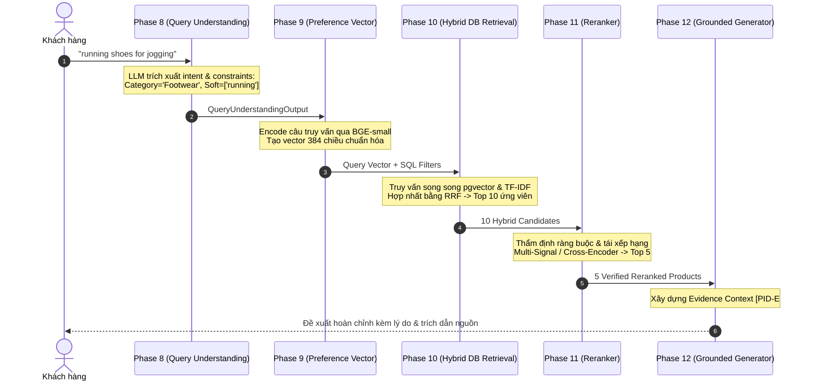

# Bài 04 — Kiến Trúc RAG & Grounded Generation Trong ShopAssist

---

## 1. RAG Là Gì? Tại Sao RAG Vượt Trội So Với Fine-Tuning Trong E-Commerce?

**RAG (Retrieval-Augmented Generation)** là kỹ thuật kết hợp giữa một hệ thống **Truy vấn thông tin (Information Retrieval - IR)** và một **Mô hình Ngôn ngữ Lớn (LLM)**. Thay vì bắt LLM phải ghi nhớ toàn bộ kiến thức thế giới trong các trọng số nơ-ron (Parametric Memory), chúng ta cung cấp cho LLM quyền truy cập vào một cơ sở dữ liệu bên ngoài (Non-parametric Memory) tại thời điểm suy luận (Inference time).

### RAG vs. Fine-Tuning: Đánh Đổi Kỹ Thuật

| Tiêu chí so sánh | Fine-Tuning (Huấn luyện lại mô hình) | RAG (Truy vấn tăng cường) |
|---|---|---|
| **Cập nhật dữ liệu mới** | Rất tốn kém, phải train lại mô hình mỗi khi có sản phẩm mới hoặc đổi giá. | **Tức thì (Real-time):** Chỉ cần thêm dòng mới vào database PostgreSQL. |
| **Độ chính xác về số liệu (Giá, Tồn kho)** | Dễ bị nhầm lẫn và ảo giác số liệu. | **Chính xác 100%:** Đọc trực tiếp từ cơ sở dữ liệu quan hệ. |
| **Khả năng trích dẫn nguồn** | Không thể (mô hình không thể chỉ ra thông tin nằm ở nơ-ron nào). | **Minh bạch tuyệt đối:** Gắn nhãn trích dẫn `[PID-E#]` trực tiếp vào từng câu. |
| **Chi phí hạ tầng** | Rất cao (yêu cầu GPU cluster để huấn luyện định kỳ). | **Thấp:** Dùng database thông thường và gọi LLM inference qua API. |

> **Quy tắc thiết kế AI Engineering:**  
> Dùng **Fine-tuning** khi cần thay đổi phong cách diễn đạt (Tone of voice) hoặc học một định dạng chuyên biệt. Dùng **RAG** khi cần thông tin chính xác, cập nhật liên tục và có thể kiểm chứng nguồn gốc.

---

## 2. Ba Trụ Cột Của Kiến Trúc RAG

Mọi hệ thống RAG đều gồm 3 giai đoạn cơ bản:

```
[Query] ---> (1. RETRIEVE) ---> [Relevant Chunks] ---> (2. AUGMENT) ---> [Prompt + Context] ---> (3. GENERATE) ---> [Answer]
```

1. **Retrieval (Truy vấn):** Tiếp nhận câu hỏi, tìm kiếm trong kho dữ liệu để lấy ra $K$ tài liệu/sản phẩm có liên quan nhất.
2. **Augmentation (Tăng cường ngữ cảnh):** Làm sạch, đóng gói và định dạng các tài liệu tìm được vào System/User Prompt, tạo thành ngữ cảnh (Context) kèm hướng dẫn trích dẫn.
3. **Generation (Sinh phản hồi):** LLM đọc ngữ cảnh được cung cấp và sinh ra câu trả lời dựa trên sự thật (Grounded Answer).

---

## 3. Tại Sao ShopAssist Là Một "Hybrid RAG System"?

Trong các ứng dụng tài liệu văn phòng (Document QA), người ta thường chia nhỏ file PDF thành các đoạn 500 từ rồi nhúng (chunking & embedding). Nhưng trong thương mại điện tử, cách làm đó sẽ thất bại:
- Một sản phẩm không chỉ có văn bản mô tả mà còn có **thuộc tính cấu trúc (Structured Metadata)**: Thương hiệu, Danh mục, Giá niêm yết, Giá khuyến mãi, Đánh giá sao, Thông số kỹ thuật dạng bảng (JSON specs).
- Một sản phẩm có các từ khóa định danh độc nhất (SKU, mã sản phẩm) mà embedding ngữ nghĩa rất dễ bỏ qua.

Do đó, ShopAssist xây dựng **Hybrid RAG**:
1. **Lọc thuộc tính cấu trúc (SQL Filter):** Giới hạn phạm vi theo danh mục và giá tiền.
2. **Tìm kiếm lai (Hybrid Retrieval):** Kết hợp cả vector tương đồng (BGE Dense Search) và từ khóa chính xác (TF-IDF Lexical Search) bằng thuật toán Reciprocal Rank Fusion (RRF).
3. **Đóng gói bằng chứng dạng thẻ (Evidence Tagging):** Chuyển đổi bảng dữ liệu thành các đoạn chứng cứ ngắn có mã định danh không thể làm giả: `[ProductID-E1] (product_name): ...`.

---

## 4. Hành Trình Chi Tiết Của Một Truy Vấn Mua Sắm (End-to-End Trace)

Hãy cùng theo dõi truy vấn `Q0001` từ khi người dùng nhập vào cho đến khi nhận được đề xuất hoàn chỉnh:



### Minh chứng dữ liệu thực tế tại từng bước:
- **Bước 1 (Phase 8 trích xuất):**
  `semantic_query: "running shoes for jogging"`, `hard_constraints: {"category": "Footwear", "currency": "INR"}`.
- **Bước 3 (Phase 10 trả về ứng viên hàng đầu):**
  - Sản phẩm 1: `7ae33aaf...` (Puma Carson 2, RRF score = 0.0322)
  - Sản phẩm 2: `855c191a...` (Puma Sequence, RRF score = 0.0307)
- **Bước 5 (Phase 12 tạo Evidence Context):**
  ```text
  [7ae33aaf60fc1ffa5d2601c92ec11304-E1] (product_name): Puma Carson 2 Concave Running Shoes
  [7ae33aaf60fc1ffa5d2601c92ec11304-E2] (price): 1899 INR
  [7ae33aaf60fc1ffa5d2601c92ec11304-E3] (category): Footwear >> Men's Shoes
  [7ae33aaf60fc1ffa5d2601c92ec11304-E4] (description): Breathable mesh upper, lightweight EVA midsole for running.
  ```
- **Bước 6 (Phase 12 sinh câu đề xuất):**
  ```json
  {
    "overview": "Dưới đây là các mẫu giày chạy bộ Puma phù hợp nhất cho nhu cầu chạy bộ của bạn:",
    "products": [
      {
        "product_id": "7ae33aaf60fc1ffa5d2601c92ec11304",
        "strengths": [
          {"claim": "Thiết kế upper dạng lưới thoáng khí và đệm EVA siêu nhẹ", "evidence_ids": ["7ae33aaf60fc1ffa5d2601c92ec11304-E4"]},
          {"claim": "Mức giá hấp dẫn 1899 INR", "evidence_ids": ["7ae33aaf60fc1ffa5d2601c92ec11304-E2"]}
        ],
        "limitations": []
      }
    ]
  }
  ```

---

## 5. Chống Ảo Giác Bằng Lớp Thẩm Định Hậu Sinh (Groundedness Validator)

Trong kiến trúc của ShopAssist, chúng ta không dừng lại ở việc yêu cầu LLM trích dẫn trong prompt. Sau khi LLM sinh xong phản hồi, một module Python tất định độc lập — **`GroundednessValidator`** — sẽ quét lại toàn bộ JSON:

1. **Kiểm tra mã sản phẩm (ID Invariant):** Nếu LLM sinh ra một `product_id` không nằm trong danh sách ứng viên mà Phase 11 đã gửi vào $\rightarrow$ **FAIL** (ngăn chặn LLM tự bịa sản phẩm ngoài catalog).
2. **Kiểm tra tiền tố trích dẫn (Citation Invariant):** Mã trích dẫn `[PID-E#]` phải có phần prefix trùng khớp với `product_id` của sản phẩm đang được nói đến. Ví dụ: Đang giới thiệu sản phẩm A mà lại trích dẫn bằng chứng của sản phẩm B $\rightarrow$ **FAIL** (chống lỗi râu ông nọ cắm cằm bà kia).
3. **Fallback Tất Định (Deterministic Fallback):** Nếu LLM bị lỗi mạng, bị rate limit hoặc cố tình sinh sai schema sau số lần retry quy định, hệ thống sẽ tự động kích hoạt hàm fallback: tự tạo câu giới thiệu cơ bản từ metadata sản phẩm mà không cần LLM, đảm bảo người dùng luôn nhận được kết quả!

---

## 6. Mã Nguồn Tham Chiếu Trong Repository

- **Xây dựng ngữ cảnh bằng chứng:** [src/shopassist/recommendation/context.py](file:///d:/Project/ShopAssist/src/shopassist/recommendation/context.py). Chứa class `EvidenceContextBuilder` với logic lọc bỏ text rác và đánh chỉ mục thẻ `[PID-E#]`.
- **Thẩm định Groundedness:** [src/shopassist/recommendation/validation.py](file:///d:/Project/ShopAssist/src/shopassist/recommendation/validation.py). Chứa class `GroundednessValidator` thực thi các kiểm tra invariant bằng code thuần.
- **Dịch vụ Đề xuất:** [src/shopassist/recommendation/core.py](file:///d:/Project/ShopAssist/src/shopassist/recommendation/core.py). Điều phối toàn bộ luồng tạo prompt, gọi provider và fallback.

---

## 7. Cạm Bẫy Thường Gặp (Common Mistakes)

1. **Đưa toàn bộ mô tả HTML thô vào Context:** Đưa hàng nghìn ký tự HTML, thẻ script hoặc các đoạn văn bản quảng cáo rác của sàn thương mại vào prompt sẽ làm tốn token vô ích và khiến LLM bị nhiễu. ShopAssist sử dụng trường `retrieval_text` đã được làm sạch kỹ càng từ Phase 5.
2. **Không có cơ chế Fallback:** Phụ thuộc 100% vào việc gọi API của bên thứ ba mà không có fallback tất định sẽ khiến ứng dụng của bạn sập ngay khi nhà cung cấp LLM gặp sự cố (như lỗi HTTP 401/429/503 mà chúng ta đã thấy trong thực nghiệm).
3. **Ảo giác thuộc tính ngầm (Implicit Attribute Hallucination):** Người dùng hỏi "giày chống nước không?", catalog không nhắc gì đến "chống nước", nhưng LLM tự suy diễn "giày thể thao chắc là chống nước được". Lớp Prompt của Phase 12 yêu cầu LLM phải thành thật thừa nhận thông tin thiếu thay vì tự ý bổ sung.

---

## 8. Bài Học Cốt Lõi (Key Takeaways)
1. **RAG là xương sống của AI sản phẩm:** Nó mang lại tính cập nhật tức thì, khả năng kiểm chứng nguồn và tiết kiệm chi phí tối đa so với fine-tuning.
2. **Thẻ bằng chứng [PID-E#] biến LLM thành công cụ trích xuất có căn cứ:** Buộc mô hình phải gắn liền từng câu khẳng định với một dòng dữ liệu cụ thể.
3. **Luôn có lớp kiểm định bằng code cứng:** Không tin tưởng hoàn toàn vào sự tự giác của LLM; hãy dùng code Python để kiểm tra lại tính hợp lệ của câu trả lời trước khi gửi tới khách hàng.
