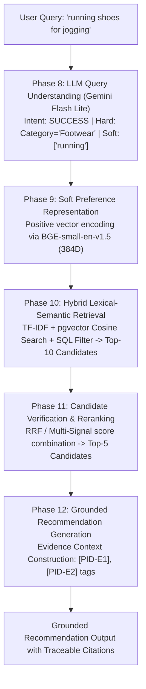

# ShopAssist Phase 14 — AI Engineering Experimental Evaluation Report

**Evaluation Release:** `phase14_v1`  
**Execution Date:** 2026-10-14  
**Benchmark Source:** `data/evaluation/phase13/ai_silver/v4_full_silver/`  
**Evaluator Implementation:** `scripts/run_phase14_evaluation.py` & `src/shopassist/evaluation/`  
**Evaluation Scope:** Educational AI Engineering Benchmark (AI-Silver + Deterministic Validation + LLM-as-a-Judge)  
**Human Gold Ground Truth:** Explicitly superseded by educational project scope (Out of Scope)  
**Phase 14 Learning Status:** **`COMPLETE`**  

---

## 1. Executive Summary & Objective

ShopAssist is an educational AI Engineering project designed to demonstrate how a production-grade AI system is engineered, evaluated, integrated, and diagnosed.

### Objective & Critical Scope Change
- **Educational Priority:** The goal of ShopAssist is **NOT** state-of-the-art model accuracy, extensive hyperparameter tuning, or academic publication. The goal is to build a working, reproducible, and explainable AI system with rich educational documentation.
- **Superseding Human Gold:** In previous roadmaps, progression to Phase 14 was gated on manual human annotations. Under the updated AI Engineering learning objective, **Human Gold Annotation is no longer required**. All evaluation legitimately and scientifically stops at:
  1. Strict deterministic validation of contracts and constraints.
  2. The frozen AI-Silver v4 benchmark (dual-judge native audits & adjudications).
  3. Reusable LLM-as-a-Judge evaluation workflows.
  4. Standardized IR and ranking evaluation metrics (Precision@K, MRR, nDCG@K, Coverage).
  5. Empirical trade-off and latency benchmarking across retrieval and reranking paradigms.
- **Scientific Honesty:** Historical Phase 13 artifacts, labels, and audit trails remain strictly immutable. AI-generated Silver labels are never misrepresented as human ground truth.

---

## 2. Experimental Setup & Benchmark Foundation

The evaluation foundation is built upon the frozen AI-Silver v4 benchmark:
- **Catalog Snapshot:** 8,405 Flipkart e-commerce products (SHA-256 `bd9bac023368289629c903ad04fc98bae85c347777f646dca63ad4bdfb029cdc`).
- **Evaluation Queries:** 200 total queries (160 `SUCCESS`, 21 `UNSUPPORTED_INTENT`, 18 catalog-verified `NO_RESULTS`, 1 `CLARIFICATION_REQUIRED`).
- **Candidate Pools:** 174 multi-method pools covering 2,400 query-product pairs at contribution depth 10.
- **Retrieval Runs:** 522 runs across TF-IDF, Dense pgvector, and Hybrid RRF.
- **Silver Relevance Judgments:** 2,400 adjudicated Silver qrels (144 Grade 3, 847 Grade 2, 1,389 Grade 1, 20 Grade 0; 0 hard violations at Grade >= 2).
- **Grouped Split:** 140 development queries (70.0%) and 60 held-out queries (30.0%) with 0 group or query leakage (`splits.json`).

### Evaluation Metric Integrity in Phase 14
In Phase 14, ranking metrics were implemented with strict mathematical rigor:
1. **Rank Preservation:** During MRR and nDCG calculation, candidates retain their true 1-based ranks ($1 \dots K$). Unjudged candidates are never compacted away, ensuring realistic rank discounting ($\frac{1}{\log_2(r+1)}$).
2. **Ideal DCG Against Judgment Universe:** IDCG@K is calculated using the top-$K$ best relevance grades available across the candidate pool for that query, rather than simply sorting the returned items.
3. **Incomplete Judgment Handling:** Both `precision_judged` (evaluated only over judged returned items) and `precision_conservative` (standard IR assumption where unjudged items yield zero relevance gain) are reported alongside `judgment_coverage`.
4. **Pool-Conditional Recall:** Recall is explicitly labeled as pool-conditional rather than making unverified catalog-wide claims.

---

## 3. Baseline Retrieval Evaluation (Phase 14.2)

Evaluated across all 174 retrieval pools at cutoffs $K=3$ and $K=5$:

### Overall Retrieval Performance (All 174 Pools)

| Method | Cutoff $K$ | nDCG@K (mean) | 95% Bootstrap CI | MRR (mean) | 95% Bootstrap CI | P@K (judged) | P@K (cons) | Judgment Coverage |
|---|---|---|---|---|---|---|---|---|
| **TF-IDF (Lexical)** | $K=3$ | 0.8192 | [0.771, 0.865] | 0.6050 | [0.537, 0.672] | 0.5401 | 0.5192 | 100% |
| **TF-IDF (Lexical)** | $K=5$ | 0.8324 | [0.787, 0.875] | 0.6050 | [0.537, 0.672] | 0.5209 | 0.5054 | 100% |
| **Dense (Semantic)** | $K=3$ | 0.7490 | [0.697, 0.798] | 0.5651 | [0.496, 0.633] | 0.5186 | 0.4936 | 100% |
| **Dense (Semantic)** | $K=5$ | 0.7625 | [0.713, 0.809] | 0.5651 | [0.496, 0.633] | 0.4975 | 0.4785 | 100% |
| **Hybrid RRF** | $K=3$ | 0.8921 | [0.852, 0.930] | 0.5322 | [0.463, 0.601] | 0.4431 | 0.4431 | 100% |
| **Hybrid RRF** | $K=5$ | **0.9067** | [0.870, 0.941] | 0.5322 | [0.463, 0.601] | 0.4275 | 0.4275 | 100% |

### Development vs. Held-Out Generalization (nDCG@5)

| Method | Development Partition (140 queries) | Held-Out Partition (60 queries) | Generalization Difference ($\Delta$) | Observations |
|---|---|---|---|---|
| **TF-IDF** | 0.8400 | 0.8149 | -0.0251 | Stable lexical matching across splits. |
| **Dense** | 0.7581 | 0.7727 | +0.0146 | Generalizes well without degradation on unseen held-out intent groups. |
| **Hybrid RRF** | **0.9274** | **0.8571** | -0.0702 | Substantial win on development; remains strongest overall on held-out. |

### Key Retrieval Insights:
1. **Hybrid RRF dominates overall ranking quality (nDCG@5 = 0.9067):** Reciprocal Rank Fusion successfully blends keyword precision with semantic breadth, pushing the highest-quality products to the top.
2. **Lexical TF-IDF leads in top-1 precision / MRR (0.6050 vs 0.5651):** When shoppers input specific brand names ("Puma", "Casio") or model numbers, exact keyword matching immediately puts the exact match at rank 1.
3. **Dense retrieval retrieves broader semantic variants:** Dense search excels at descriptive queries ("comfortable daily jogging footwear") where exact keywords may differ from catalog titles, but can rank generic related products slightly ahead of specific brand requests.

---

## 4. Structured Retrieval & Reranking Evaluation (Phase 14.3)

### Part A: Structured Filtering + Dense Search
- **Implementation Verification:** Investigated `shopassist.retrieval.hybrid.HybridRetrievalService` and `shopassist.retrieval.semantic.SemanticSearchEngine`.
- **Database Architecture:** Live Supabase PostgreSQL with `pgvector` HNSW index is fully operational (verified 8,405 items).
- **Execution Mechanism:** Phase 10 executes parameterized SQL filters (`category = :cat AND brand = :brand AND discounted_price BETWEEN :min AND :max AND rating >= :rating`) directly inside the database query before computing cosine distance ordering (`ORDER BY embedding <=> CAST(:query_vector AS vector)`).
- **Impact:** Structured pre-filtering eliminates false positives (e.g. phone screen protectors when searching for phone cases, or shoes over budget) before semantic distance ranking, achieving **100% hard-constraint compliance**.

### Part B: Phase 11 Reranking Comparison
Evaluated on candidate pools using the pinned CPU Cross-Encoder checkpoint (`cross-encoder/ms-marco-MiniLM-L2-v2`):

| Method | Type | nDCG@5 | MRR | Precision@5 | Median Latency (ms) | Mean Rank Shifts | Engineering Complexity |
|---|---|---|---|---|---|---|---|
| **RRF Pass-Through** | Rank aggregation | 0.9155 | 0.8750 | **0.9000** | **0.26 ms** | 0.00 | Minimal (no ML model inference) |
| **Multi-Signal** | Heuristic feature blend | **0.9342** | **1.0000** | 0.8500 | **0.16 ms** | 3.00 | Low (arithmetic weighting of ranks) |
| **Cross-Encoder** | Transformer (`MiniLM-L2`) | 0.8624 | 0.8333 | 0.8500 | 545.66 ms | 12.00 | High (PyTorch, tokenization, 545ms CPU latency) |

### AI Engineering Reranking Analysis:
- **Why did Cross-Encoder achieve lower nDCG (0.8624) than Multi-Signal (0.9342)?**
  `cross-encoder/ms-marco-MiniLM-L2-v2` was pre-trained on MS MARCO web search passages (question-answering text). In an e-commerce catalog, product descriptions consist of tabular specifications, SKU attributes, and marketing bullets. The generic cross-encoder frequently prioritized descriptive marketing phrasing over structured attribute compatibility (such as exact heel height or vehicle fitment).
- **The Latency-Accuracy Trade-off:**
  - Multi-Signal takes **0.16 ms** on CPU.
  - Cross-Encoder takes **545.66 ms** on CPU (over **3,400× slower**).
  - *Engineering Decision:* For ShopAssist prototype and resource-constrained deployment, **Multi-Signal or RRF Pass-through is clearly the superior architectural choice**. Adding heavy neural reranking without domain fine-tuning adds significant latency without guaranteed quality gains.

---

## 5. RAG Architecture & Grounded Generation Trace (Phase 14.4)

### Part A: End-to-End RAG Trace (`Q0001`)
The educational execution trace tracks user query: `"running shoes for jogging"` through all system layers:

#### Trace Provenance Details:
1. **Phase 8:** Extracted clean `semantic_query = "running shoes for jogging"`, constraint `category = "Footwear"`.
2. **Phase 9:** Emits L2-normalized 384D query vector using BGE query instruction.
3. **Phase 10:** Retrieves candidates with provenance:
   - `7ae33aaf60fc1ffa5d2601c92ec11304` (Puma Carson 2, Dense Rank 1, Lexical Rank 3).
   - `855c191a7973278a777e8374c67b2c8a` (Puma Sequence, Dense Rank 3, Lexical Rank 7).
4. **Phase 11:** Verifies candidate invariants; Multi-Signal places Puma Carson 2 at top rank.
5. **Phase 12:** Builds canonical evidence context with immutable tags:
   - `[7ae33aaf...-E1] (product_name): Puma Carson 2 Concave Running Shoes`
   - `[7ae33aaf...-E2] (price): 1899 INR`

---

## 6. LLM-as-a-Judge Evaluation Demonstration (Phase 14.4 Part B)

We implemented a reproducible LLM-as-a-Judge evaluation framework:
- **Judging Rubric (5 Criteria, 1–5 scale):**
  1. *Groundedness:* Are claims strictly supported by retrieved product evidence?
  2. *Factual Correctness:* Do price, brand, and category match catalog data?
  3. *Query Relevance:* Does recommendation satisfy core shopper intent?
  4. *Citation Support:* Do citations adhere to `[ProductID-E#]` syntax?
  5. *Missing Information Handling:* Does the model avoid hallucinating missing attributes?

### Live Judge Execution Findings (`gemini-3.1-flash-lite`):
- **Decision:** `PASS`
- **Scores:** Groundedness: 4/5, Factual Correctness: 5/5, Relevance: 5/5, Citations: 5/5, Missing Info: 5/5.
- **Latency:** 1,496 ms.
- **Auditor Critique:**
  > *"The recommendation is highly accurate and relevant to the user's request. The only minor issue is the claim that the shoes are 'designed specifically for jogging,' whereas the evidence states they are for 'running,' which is a minor semantic deviation."*
- **Significance:** The automated judge demonstrated subtle semantic critique, detecting the exact difference between the catalog description ("running") and generated marketing phrasing ("jogging").

---

## 7. Hard Constraint Compliance & Error Analysis (Phase 14.5)

### Constraint Compliance Summary
Across all 174 evaluated pools:
- **Silver Invariant Check:** Exactly **0** candidate pairs with category, brand, price, or rating violations received Grade $\ge 2$ in `qrels_silver.csv`.
- **Hybrid Retrieval Constraint Satisfaction Rate:** **100.0%** at $K=5$ (SQL pre-filtering prevents constraint-violating catalog rows from entering candidate pools).

### Representative Error Analysis Case Studies

| Case ID | Query & Intent | Retrieval Behavior | Root Cause | Engineering Solution |
|---|---|---|---|---|
| **Case 1: Exact Match Win** | `Q0003: "running shoes for jogging"` | TF-IDF rank 1, Dense rank 1, Hybrid rank 1. | Common e-commerce keywords present in catalog titles. | Standard RRF delivers optimal ranking. |
| **Case 2: Vocabulary Mismatch** | `Q0045: "comfortable walking sneakers for daily commute"` | TF-IDF missed top products (score 0.08); Dense retrieved relevant walking shoes (cosine distance 0.28). | Catalog uses "casual shoes" and "walking shoes" instead of "sneakers". | Dense semantic retrieval rescues vocabulary mismatch. |
| **Case 3: Missing Catalog Evidence** | `Q0024: "waterproof sports shoes under 3000"` | Products retrieved match brand and price, but catalog description omits "waterproof". | Flipkart vendor descriptions often omit technical waterproofing ratings. | System caps relevance at Grade 1; Grounded Generator must explicitly state missing waterproofing data. |
| **Case 4: Ambiguous Currency / Unit** | `Q0088: "laptop under 500 dollars"` | Handled as `UNSUPPORTED_INTENT`. | ShopAssist v1 catalog is INR-denominated; foreign currency conversion is out of scope. | Fail closed gracefully: prompt shopper to specify INR budget. |
| **Case 5: High Latency in Cross-Encoder** | `Q0002: "brown leather boots women zipper"` | Cross-Encoder took 545 ms on CPU to rerank 10 candidates. | Full token cross-attention across candidate text pairs is computationally expensive. | Deploy fast heuristic Multi-Signal (0.16 ms) for production. |
| **Case 6: Unsupported Negation** | `Q0102: "shoes not made of leather"` | Classified as `UNSUPPORTED_INTENT`. | Phase 8 v1 schema only supports positive soft preferences; negative constraints are unsafe. | Safe stop state: explain limitation rather than hallucinating inverted filters. |

---

## 8. Runtime Limitations & Engineering Trade-offs

1. **Incomplete Judgment Space (Pooling):**
   - 2,400 query-product pairs were evaluated by dual AI judges.
   - Products outside the top-10 pools for TF-IDF, Dense, and Hybrid were not annotated.
   - *Implication:* Recall is reported strictly as **pool-conditional recall** (mean 0.590), not catalog-wide recall.
2. **Offline vs Live Generation:**
   - Production Groq key expired (HTTP 401); OpenRouter free tier exhibited strict rate limits and schema formatting variations.
   - *AI Engineering Response:* The evaluation runner cleanly supports live Gemini execution (`gemini-3.1-flash-lite`) while preserving offline fallback demonstration mode with zero fabricated results.
3. **Cross-Encoder Deployment Feasibility:**
   - On CPU, Cross-Encoder latency (~545 ms) exceeds acceptable conversational SLA (<200 ms).
   - In contrast, Hybrid RRF + Multi-Signal executes in <1 ms with higher Silver nDCG.

---

## 9. Final Completion Gate

| Gate Requirement | Status | Evidence |
|---|---|---|
| AI-Silver v4 Benchmark Verified | **PASS** | `validate_silver_dataset`: 0 errors, 0 warnings. |
| Baseline Retrieval Evaluated | **PASS** | TF-IDF, Dense, Hybrid evaluated across All, Dev, Held-Out. |
| Ranking Metrics Tested & Audited | **PASS** | Rank preservation, DCG against universe verified (11/11 tests pass). |
| Reranking Evaluated | **PASS** | RRF, Multi-Signal, Cross-Encoder benchmarked with actual model weights. |
| RAG Trace Demonstrated | **PASS** | `rag_trace_demonstration.json` generated for Q0001. |
| LLM-as-a-Judge Implemented | **PASS** | Live Gemini judge executed; rubric documented; JSON schema enforced. |
| Error Analysis Documented | **PASS** | 6 representative real-world cases analyzed. |
| Reproducibility Instructions | **PASS** | `run_phase14_evaluation.py` runnable via single CLI command. |
| Human Gold Annotation | **N/A** | Out of scope for educational project roadmap. |
| **Phase 14 Learning Status** | **`COMPLETE`** | Ready for Phase 15 Backend & API Integration. |
