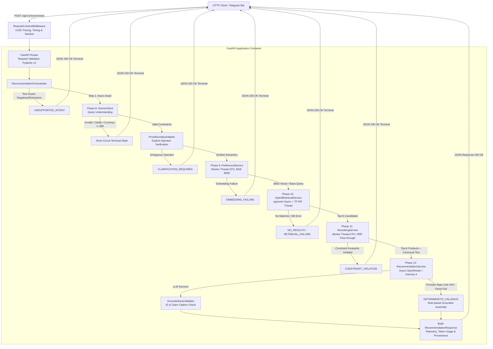

# Phase 15 — FastAPI Backend & End-to-End AI Pipeline Orchestration

**Contract version:** `1.0.0`  
**Status:** **IMPLEMENTED — PENDING LIVE THIRD-PARTY VALIDATION**  
**Component:** `shopassist.api`  
**Target Branch:** `feat/phase15-fastapi-backend`  

---

## 1. Executive Summary & Objective

Phase 15 delivers a production-grade, asynchronous RESTful API backend for the ShopAssist conversational product recommendation system. Built on **FastAPI** and **Pydantic v2**, this layer seamlessly unifies the existing modular AI capabilities developed across Phases 8 through 12:

- **Phase 8:** Gemini LLM Query Understanding & Hard Constraint Extraction
- **Phase 9:** Positive Soft Preference Representation & BGE 384D Vector Encoding
- **Phase 10:** Hybrid Candidate Retrieval (pgvector dense search + TF-IDF lexical retrieval with RRF)
- **Phase 11:** Product Reranking & Canonical Retrieval Text Resolution
- **Phase 12:** Grounded LLM Recommendation Generation with Deterministic Fallbacks

The backend serves as the core integration hub, providing strongly-typed JSON endpoints, robust exception handling, request tracing, observability metrics, resource lifecycle management, and a conversation session foundation preparing for Phase 16 Telegram Bot integration.

---

## 2. System Architecture

The following diagram illustrates the complete Phase 15 backend architecture and end-to-end AI pipeline flow:



---

## 3. Directory & Package Structure

The backend implementation resides cleanly under `src/shopassist/api/`, maintaining strict separation of concerns:

```text
src/shopassist/api/
├── __init__.py                 # API package metadata & version
├── main.py                     # Application factory (create_app) & lifespan manager
├── config.py                   # Pydantic BaseSettings for API runtime parameters
├── schemas.py                  # Public Pydantic v2 request/response contracts
├── price_adapter.py            # Verified PriceBoundaryAdapter for Phase 8->10 handoff
├── session.py                  # In-memory bounded conversation store with TTL
├── dependencies.py             # FastAPI Depends injection providers
├── exceptions.py               # Custom exception classes & global exception handlers
├── middleware/
│   ├── __init__.py
│   └── request_context.py      # UUID request_id, timing, logging, secret masking
├── routes/
│   ├── __init__.py
│   ├── health.py               # GET /api/v1/health & GET /api/v1/health/live
│   └── recommendations.py      # POST /api/v1/recommend & POST /recommend alias
└── services/
    ├── __init__.py
    └── orchestrator.py         # RecommendationOrchestrator coordinating Phases 8–12
```

---

## 4. Resource Lifecycle & Lifespan Architecture

Expensive neural models, database connection pools, and retrieval artifacts must never be re-instantiated on a per-request basis. Phase 15 utilizes FastAPI's `lifespan` context manager to initialize and maintain shared singleton instances across the entire application lifecycle:

### 4.1. Startup Sequence
1. **Windows Event Loop Policy:** Configures `WindowsSelectorEventLoopPolicy` required by `psycopg` async driver.
2. **SQLAlchemy AsyncEngine:** Initializes persistent connection pool (`pool_size=5`, `max_overflow=2`, `pool_pre_ping=True`).
3. **TF-IDF Retrieval Index:** Loads serialized document-term matrix and vectorizer from `data/processed/tfidf/` (8,405 product documents).
4. **Dense Query Encoder:** Initializes `DenseQueryEncoder` loading `BAAI/bge-small-en-v1.5` (384 dimensions) once, sharing the weights between Phase 9 preference representation and Phase 10 base-query encoding.
5. **Canonical Product Text Provider:** Ingests `data/processed/products.parquet` (8,405 products) into memory for rapid Phase 11 canonical text resolution and Phase 12 evidence extraction.
6. **Core Pipeline Services:** Instantiates `QueryUnderstandingEngine`, `PreferenceRepresentationService`, `HybridRetrievalService`, `RerankingService`, and `RecommendationService`.
7. **Session Store:** Allocates `InMemorySessionStore` with 1-hour TTL and 10-message turn bounding.
8. **Orchestrator Singleton:** Binds all services into `RecommendationOrchestrator` attached to `app.state`.

### 4.2. Shutdown Sequence
On ASGI server shutdown, resources are cleanly disposed:
- `await query_engine.client.aclose()` terminates Gemini httpx sessions.
- `await provider._http_client.aclose()` terminates OpenRouter httpx connections.
- `await engine.dispose()` drains and terminates the PostgreSQL connection pool.

---

## 5. Async / Sync Partitioning Strategy

FastAPI executes all route handlers on a single asyncio event loop. Blocking the event loop with compute-heavy neural inference or sparse matrix math severely degrades backend throughput.

Phase 15 enforces strict execution partitioning:

| Pipeline Stage | Operation Type | Execution Target | Rationale |
|---|---|---|---|
| Phase 8 Query Understanding | Async I/O | Event loop (`await`) | Non-blocking remote Google Gemini API call |
| Phase 9 BGE Embedding | CPU-bound | Worker threadpool (`asyncio.to_thread`) | PyTorch matrix operations must not block HTTP loop |
| Phase 10 pgvector Search | Async I/O | Event loop (`await`) | Non-blocking asyncpg/psycopg database query |
| Phase 10 TF-IDF Search | CPU-bound | Worker threadpool (`asyncio.to_thread`) | SciPy CSR sparse dot product |
| Phase 11 RRF Reranking | CPU-bound | Worker threadpool (`asyncio.to_thread`) | In-memory sorting and candidate dictionary lookup |
| Phase 12 LLM Generation | Async I/O | Event loop (`await`) | Non-blocking OpenRouter/Groq HTTP streaming |

---

## 6. Price-Boundary Semantics Adapter

### Problem
Phase 8 Schema v1 extracts numeric bounds (`min_price: 3000.0`, `max_price: 3000.0`) but lacks operator inclusivity flags (`min_inclusive`, `max_inclusive`). Phase 10's strict boundary safeguard deliberately rejects price-bounded queries with `UNSUPPORTED_INTENT` if boundary semantics are ambiguous.

### Solution
`PriceBoundaryAdapter` performs deterministic, rule-based natural language parsing on the original query string to safely establish operator intent without modifying Phase 8 v1 or guessing:

- **Strict `<` (exclusive):**
  - Patterns: `under \d+`, `below \d+`, `less than \d+`, `cheaper than \d+`, `dưới \d+`, `thấp hơn \d+`, `nhỏ hơn \d+`
  - Output: `{"max_inclusive": False}`
- **Inclusive `<=` (at most):**
  - Patterns: `up to \d+`, `at most \d+`, `maximum \d+`, `max \d+`, `not exceeding \d+`, `within \d+`, `tối đa \d+`, `không quá \d+`, `nhiều nhất \d+`, `\d+ đổ lại`
  - Output: `{"max_inclusive": True}`
- **Strict `>` (exclusive):**
  - Patterns: `above \d+`, `over \d+`, `more than \d+`, `higher than \d+`, `trên \d+`, `cao hơn \d+`, `lớn hơn \d+`
  - Output: `{"min_inclusive": False}`
- **Inclusive `>=` (at least):**
  - Patterns: `at least \d+`, `minimum \d+`, `from \d+`, `tối thiểu \d+`, `ít nhất \d+`, `từ \d+`
  - Output: `{"min_inclusive": True}`
- **Explicit Range:**
  - Patterns: `between X and Y`, `from X to Y`, `từ X đến Y`
  - Output: `{"min_inclusive": True, "max_inclusive": True}`
- **Ambiguous Phrasing:**
  - Patterns: `around \d+`, `khoảng \d+`, `tầm \d+`, `budget of \d+`
  - Output: `is_resolved = False` -> Triggers safe `CLARIFICATION_REQUIRED` stop. **Never silently assumes inclusive.**

---

## 7. Session & Multi-turn Foundation (Phase 16 Preparation)

The `InMemorySessionStore` provides conversation turn caching for the upcoming Phase 16 Telegram Bot:
- **Identifier:** `session_id` string passed optionally in `RecommendationRequest`.
- **Turn Storage:** Stores recent pairs of `user_query`, `assistant_overview`, `status`, and `timestamp`.
- **Bounding:** Keeps a sliding window of the latest 10 messages per session.
- **TTL Eviction:** Automatically evicts sessions inactive for over 3,600 seconds (1 hour).
- **Safety Invariant:** The session store **does not** automatically carry forward inferred budgets, brands, or exclusions from prior turns into unrelated queries, preventing context leakage.

---

## 8. Observability & Telemetry

Every API request produces comprehensive tracing and performance telemetry:
- **Tracing:** Unique UUID4 `request_id` passed via response header `X-Request-ID`.
- **Timing:** Request latency measured and returned in header `X-Response-Time-MS` and response body `usage.total_latency_ms`.
- **Stage Breakdown:** `usage.stage_latencies_ms` provides millisecond resolution for:
  - `phase8_query_understanding`
  - `phase9_preferences`
  - `phase10_hybrid_retrieval`
  - `phase11_reranking`
  - `phase12_recommendation`
- **Token Consumption:** Aggregates prompt and completion tokens from Phase 8 (Gemini) and Phase 12 (OpenRouter/Groq).
- **Cost Estimation:** Calculates total USD cost per request.
- **Sanitized Logging:** All request headers and parameters are logged with credentials, database passwords, and API keys redacted.
