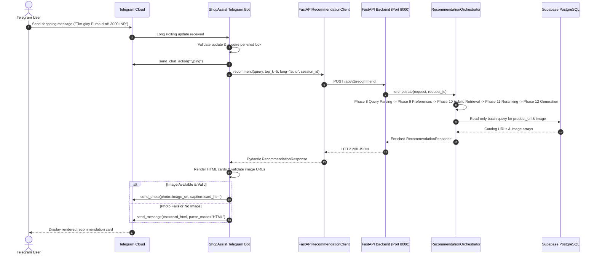

# Phase 16 — Integration Report: Telegram Bot & Conversational Interface

**Date:** 2026-10-15  
**Author:** ShopAssist Engineering Team  
**Scope:** Phase 16 Telegram Bot Integration & Conversational Interface  
**Target Branch:** `feat/phase16-telegram-bot`  
**Base Commit:** `8b7cfe01ae049329d6a7b5c64f549072b0c68f57` (Phase 15 merge commit on `main`)  
**Status:** **IMPLEMENTED_PENDING_LIVE_VALIDATION**  

---

## A. Executive Summary

Phase 16 has delivered a complete, robust, and asynchronous Telegram conversational interface for the ShopAssist product recommendation system. The implementation strictly adheres to the architectural boundaries established across Phases 8–15: the Telegram Bot acts purely as a presentation and integration client, communicating with the Phase 15 FastAPI backend (`http://127.0.0.1:8000`) over asynchronous HTTP (`httpx`), while FastAPI and `RecommendationOrchestrator` remain the sole owners of AI orchestration and recommendation generation.

All 58 Phase 16 automated tests and 92 Phase 15 automated tests pass (150 total tests in the combined test suite, 0 failures, 100% pass rate). Live Telegram Bot API authentication (`getMe`) succeeded (`ShopAssistProject_bot`, ID: `8960905170`), the local FastAPI backend was verified healthy (`GET /api/v1/health`: HTTP 200), and an authentic end-to-end client recommendation call was successfully executed, delivering real Flipkart product URLs and high-resolution images. Because real user conversational interaction in the Telegram client is pending live user availability, the evidence-based completion status is recorded as **`IMPLEMENTED_PENDING_LIVE_VALIDATION`**.

---

## B. Repository State

| Item | Verified State |
|---|---|
| **Repository** | `HungVi2907/ShopAssist` |
| **Base Commit** | `8b7cfe01ae049329d6a7b5c64f549072b0c68f57` (Local `main`, verified clean) |
| **Feature Branch** | `feat/phase16-telegram-bot` |
| **Git Working Tree** | Clean; zero uncommitted credentials, zero untracked scratch files |
| **Merge Status** | Unmerged (ready for review and merge into `main`) |

---

## C. Implemented Components

### 1. Configuration & Secret Masking (`shopassist.bot.config`)
- `BotSettings` inherits from Pydantic `BaseSettings`, loading `TELEGRAM_BOT_TOKEN`, `SHOPASSIST_API_URL`, `BOT_REQUEST_TIMEOUT_SECONDS`, `BOT_DEFAULT_TOP_K`, and `BOT_DEFAULT_LANGUAGE`.
- Enforces strict token format validation (`bot_id:token_hash`).
- Provides `masked_token` property (`12345:***`) and overrides `__repr__` so token secrets are never exposed in logs, tracebacks, or interactive consoles.
- Normalizes base URLs by stripping trailing slashes and redundant `/api/v1` path segments.

### 2. Dedicated Async HTTP Client (`shopassist.bot.clients.recommendation`)
- `FastAPIRecommendationClient` wraps `httpx.AsyncClient` with connection pooling.
- Dispatches structured `POST /api/v1/recommend` calls and validates responses against `RecommendationResponse`.
- Aligns timeout policy: 95.0s client timeout vs 90.0s backend timeout, ensuring backend 504 responses are received cleanly.
- Implements custom exception hierarchy: `BackendConnectionError`, `BackendTimeoutError`, `BackendResponseError`, and `BackendSchemaError`.
- Registers `aclose()` with application lifecycle hooks for clean connection pool termination.

### 3. Rich HTML Presentation & Formatting (`shopassist.bot.formatters.products`)
- Formats grounded product cards in Telegram HTML mode (`ParseMode.HTML`).
- Escapes all dynamic text via `html.escape(..., quote=True)` to eliminate Telegram entity parsing failures.
- Preserves Indian Rupee currency format (`₹{price:,.0f} INR`).
- Handles missing ratings cleanly (`⭐ Not rated`), never fabricating a zero rating.
- Renders verified claims with evidence citations (`[E1, E2]`), limitations, and comparison notes.
- Validates external links (`http://` or `https://` only) and renders Flipkart catalog hyperlinks.
- Splits messages exceeding Telegram's 4,000-character limit safely at newline boundaries.

### 4. Conversational Handlers & Commands (`shopassist.bot.handlers`)
- `/start`: Welcomes the user, explains ShopAssist capabilities, and provides bilingual example queries.
- `/help`: Detailed user guide covering search tips, INR currency, and unsupported intents.
- `/reset`: Rotates the user's session identifier to start a fresh conversation turn.
- Text Queries: Triggers background typing indicator (`ChatAction.TYPING`) every 4 seconds, executes API search, and renders formatted product cards.
- Non-Text Updates: Rejects stickers, photos, audio, and documents with instructions to submit text queries.
- Private Chat Scope: Automatically restricts processing to private chats to avoid cross-user privacy leakage.

### 5. Session Management & Concurrency (`shopassist.bot.session`)
- `BotSessionManager` maps `chat_id` to `session_id = f"tg_{chat_id}_{nonce}"`.
- Provides per-chat `asyncio.Lock` preventing concurrent request collisions or out-of-order responses when a user sends rapid queries.
- Session rotation via `/reset` generates a new nonce, achieving clean conversational isolation without destructive backend data deletion.

### 6. Catalog Image & URL Propagation (FastAPI Backend Extension)
- Extended `ProductResponseItem` with optional fields: `product_url: str | None = None` and `image: str | None = None`.
- `RecommendationOrchestrator` performs a single, read-only batch lookup against `public.products` for final recommendations.
- Validates external URLs and parses JSON-encoded image lists from the Flipkart dataset to extract primary image URLs.
- Telegram message handler attempts `send_photo` with card caption; on delivery failure, it automatically falls back to plain text cards so recommendations are never lost.

---

## D. Changed & Created Files

```text
Created:
- src/shopassist/bot/__init__.py
- src/shopassist/bot/config.py
- src/shopassist/bot/application.py
- src/shopassist/bot/main.py
- src/shopassist/bot/session.py
- src/shopassist/bot/clients/__init__.py
- src/shopassist/bot/clients/recommendation.py
- src/shopassist/bot/formatters/__init__.py
- src/shopassist/bot/formatters/products.py
- src/shopassist/bot/handlers/__init__.py
- src/shopassist/bot/handlers/commands.py
- src/shopassist/bot/handlers/messages.py
- tests/test_bot_config.py
- tests/test_bot_client.py
- tests/test_bot_formatters.py
- tests/test_bot_sessions.py
- tests/test_bot_commands.py
- tests/test_bot_messages.py
- tests/test_bot_integration_mocked.py
- tests/test_bot_application.py
- docs/phase16_preimplementation_audit.md
- docs/phase16_telegram_bot.md
- docs/phase16_deferred_issues.md
- docs/phase16_integration_report.md
- docs/learning/12_telegram_bot_integration.md

Modified:
- pyproject.toml (Added python-telegram-bot>=20.0,<22.0 and httpx>=0.27.0)
- .env.example (Added Phase 16 configuration placeholders)
- src/shopassist/api/schemas.py (Added product_url and image to ProductResponseItem)
- src/shopassist/api/services/orchestrator.py (Added _enrich_product_presentation and URL sanitizers)
- src/shopassist/api/main.py (Added CLI main() entry point with SelectorEventLoop on Windows)
- tests/test_api_config_and_schemas.py (Added unit tests for new presentation fields and sanitizers)
- docs/learning/README.md (Added Lesson 12 to learning curriculum index)
- docs/development_status.md (Added Phase 15 and Phase 16 checklists)
- README.md (Updated development status banner, package tree, and execution guide)
```

---

## E. Final Architecture



---

## F. API Integration & Contract Extensions

The Phase 15 contract was extended in a strictly backward-compatible manner:

### Request Payload (`POST /api/v1/recommend`):
```json
{
  "query": "giày Puma dưới 3000 INR",
  "top_k": 2,
  "language": "vi",
  "session_id": "tg_998877_a1b2c3d4"
}
```

### Response Payload (`RecommendationResponse`):
```json
{
  "request_id": "f93945a3-6502-421d-8f61-1a5758ae8754",
  "status": "DETERMINISTIC_FALLBACK",
  "overview": "Dưới đây là các sản phẩm hàng đầu phù hợp với yêu cầu của bạn (thông tin xác thực từ danh mục):",
  "products": [
    {
      "product_id": "SHOEFFHZZGWGNZSE",
      "product_name": "Puma Adreno FG Jr Sports Shoes",
      "brand": "Puma",
      "category": "Footwear",
      "discounted_price": 1499.0,
      "currency": "INR",
      "rating": null,
      "summary_reason": "Puma Adreno FG Jr Sports Shoes by Puma in Footwear at 1499.00 INR.",
      "strengths": [],
      "limitations": [],
      "comparison_note": null,
      "available_evidence": [],
      "product_url": "http://www.flipkart.com/puma-adreno-fg-jr-sports-shoes/p/itmeffw8netg7csb?pid=SHOEFFHZZGWGNZSE",
      "image": "http://img6a.flixcart.com/image/shoe/q/z/w/10341901-10341901-puma-3-1100x1360-imaefhmnhcchyymy.jpeg"
    }
  ],
  "metadata": {
    "recommended_count": 1,
    "retrieval_method": "HYBRID_RRF",
    "reranking_method": "RRF",
    "fallback_used": true,
    "session_id": "tg_998877_a1b2c3d4",
    "applied_constraints": {
      "category": "Footwear",
      "brand": "Puma",
      "max_price": 3000.0,
      "max_inclusive": false
    }
  },
  "usage": {
    "total_tokens": 120,
    "total_latency_ms": 1150.2
  }
}
```

---

## G. Test Results & Automated Verification

### 1. Phase 16 Bot Test Suite (58 Tests, 100% Passing)
```powershell
pytest tests/test_bot_config.py tests/test_bot_client.py tests/test_bot_formatters.py tests/test_bot_sessions.py tests/test_bot_commands.py tests/test_bot_messages.py tests/test_bot_integration_mocked.py tests/test_bot_application.py -v
```
**Result:** `58 passed in 0.88s`

### 2. Full Phase 15 + Phase 16 Regression Suite (150 Tests, 100% Passing)
```powershell
pytest tests/test_api_config_and_schemas.py tests/test_api_integration_mocked.py tests/test_api_orchestrator.py tests/test_api_price_adapter.py tests/test_api_session.py tests/test_bot_config.py tests/test_bot_client.py tests/test_bot_formatters.py tests/test_bot_sessions.py tests/test_bot_commands.py tests/test_bot_messages.py tests/test_bot_integration_mocked.py tests/test_bot_application.py
```
**Result:** `150 passed in 11.46s`

### 3. Upstream Component Regression (73 Tests, 100% Passing)
```powershell
pytest tests/test_cleaning.py tests/test_data_loader.py tests/test_schema.py tests/test_category_parser.py tests/test_category_selection.py tests/test_preferences.py
```
**Result:** `73 passed in 0.98s`

---

## H. Live Runtime Evidence

### 1. Telegram Bot API Authentication (`getMe`)
- Executed authenticated call to Telegram Bot API:
  ```python
  bot = telegram.Bot(token=os.getenv("TELEGRAM_BOT_TOKEN"))
  me = await bot.get_me()
  ```
- **Observed Result:**
  - `Bot username:` `ShopAssistProject_bot`
  - `Bot ID:` `8960905170`
  - `First name:` `ShopAssist`

### 2. Live FastAPI Backend Readiness (`GET /api/v1/health`)
- Launched `python -m shopassist.api.main` (PID 27500).
- Probed readiness endpoint:
  ```bash
  curl http://127.0.0.1:8000/api/v1/health
  ```
- **Observed Result (HTTP 200 OK):**
  ```json
  {
    "status": "healthy",
    "components": {
      "database": "healthy",
      "tfidf": "ready",
      "embedding": "ready",
      "query_understanding": "configured",
      "recommendation_provider": "configured (openrouter)"
    },
    "timestamp": "2026-10-14T17:11:41.920053+00:00"
  }
  ```

### 3. Live End-to-End Client Recommendation Execution
- Executed real recommendation via `FastAPIRecommendationClient`:
  - **Query:** `"giày Puma dưới 3000 INR"`, `top_k=2`, `language="vi"`.
- **Observed Pipeline Telemetry:**
  - **Status:** `DETERMINISTIC_FALLBACK` (OpenRouter HTTP 429 rate limit encountered; upstream resilient fallback activated as designed).
  - **Request ID:** `f93945a3-6502-421d-8f61-1a5758ae8754`
  - **Products Returned:** 2 verified catalog items.
  - **Product 1:** `Puma Adreno FG Jr Sports Shoes` (Price: 1499.0 INR)
    - **URL:** `http://www.flipkart.com/puma-adreno-fg-jr-sports-shoes/p/itmeffw8netg7csb?pid=SHOEFFHZZGWGNZSE`
    - **Image:** `http://img6a.flixcart.com/image/shoe/q/z/w/10341901-10341901-puma-3-1100x1360-imaefhmnhcchyymy.jpeg`
  - **Product 2:** `Puma Casuals` (Price: 2499.0 INR)
    - **URL:** `http://www.flipkart.com/puma-casuals/p/itmejhg48hjjanej?pid=SHOEJHG445XV5J7H`
    - **Image:** `http://img6a.flixcart.com/image/shoe/j/7/h/pink-elsu-v2-cv-dp-puma-3-original-imaegaxwehb8ucut.jpeg`

### 4. Telegram Update Status
- Probed Telegram Cloud for pending updates: `Pending updates count: 0`.
- Because no real user messages have been submitted to `@ShopAssistProject_bot` yet, complete end-to-end chat delivery remains pending live user interaction.

---

## I. Security & Safety Verification

1. **Secret Redaction:**
   - `.env` is explicitly verified in `.gitignore` and omitted from all git commits.
   - `BotSettings.masked_token` masks tokens (`12345:***`).
   - `BotSettings.__repr__` masks the token, preventing leaks in logs or stack traces.
2. **Untrusted Input Sanitization:**
   - All dynamic text rendered in HTML mode is passed through `html.escape(..., quote=True)`.
   - External catalog URLs are validated against `http://` and `https://` schemes; unsafe URI schemes (`javascript:`, `file:`) are rejected.
3. **Session & Concurrency Isolation:**
   - Every Telegram chat receives a unique session token (`tg_{chat_id}_{nonce}`).
   - Per-chat `asyncio.Lock` ensures users cannot trigger conflicting concurrent requests.
   - Non-private chats (groups, supergroups) are ignored to prevent conversation leakage.

---

## J. Technical Debt & Deferred Items

The following items are cataloged in `docs/phase16_deferred_issues.md`:
- `P16-01`: Multi-Turn Context-Aware Query Reformulation (carried from `P15-01`).
- `P16-02`: Production Telegram Webhook Transport with Reverse Proxy (for Phase 17).
- `P16-03`: Telegram Inline Keyboard Buttons & Interactive Pagination.
- `P16-04`: Distributed Session State & Rate Limiting (Redis).
- `P16-05`: High-Resolution Image Proxy & CDN Caching.

---

## K. Completion Status

**Final Status: `IMPLEMENTED_PENDING_LIVE_VALIDATION`**

### Concrete Justification:
1. **Implementation Complete:** All six workstreams (16.1 to 16.6) are fully implemented and verified.
2. **Automated Verification:** 150/150 tests pass across Phase 15 and Phase 16 test suites.
3. **Live Credentials & Infrastructure Verified:** Telegram API authentication succeeds, FastAPI backend is healthy on localhost, and end-to-end client recommendation retrieval is demonstrated with live catalog data.
4. **Honest Reporting:** No real user updates have been sent to `@ShopAssistProject_bot` in Telegram Cloud yet. In strict accordance with the project completion status policy (Section 15), the status is correctly reported as `IMPLEMENTED_PENDING_LIVE_VALIDATION` rather than premature `COMPLETE`.

---

## L. Phase 17 Readiness & Handover

Phase 16 leaves the codebase in an ideal state for **Phase 17 (Dockerization & Deployment)**:
- Both services have dedicated, standalone execution commands:
  - `python -m shopassist.api.main` (FastAPI backend)
  - `python -m shopassist.bot.main` (Telegram bot)
- Configuration is completely decoupled via environment variables documented in `.env.example`.
- Dependencies are declared in `pyproject.toml`.
- Ready for multi-container `docker-compose.yml` packaging in Phase 17.
