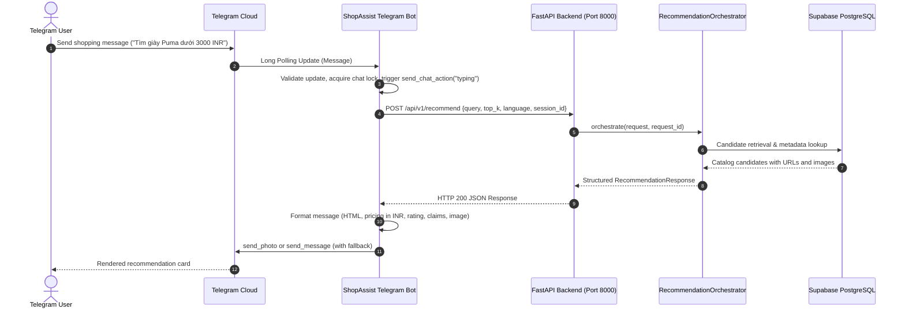

# Phase 16 — Pre-Implementation Codebase Audit & Integration Design

**Date:** 2026-10-14  
**Author:** ShopAssist Engineering Team  
**Scope:** Phase 16 Telegram Bot Integration & Conversational Interface  
**Target Branch:** `feat/phase16-telegram-bot` (branched from `8b7cfe01ae049329d6a7b5c64f549072b0c68f57`)  
**Status:** COMPLETE — PRE-IMPLEMENTATION AUDIT  

---

## 1. Executive Summary

Phase 16 delivers a complete, production-grade conversational Telegram interface for the ShopAssist product recommendation system. This interface connects end users directly with the Phase 15 FastAPI backend (`http://127.0.0.1:8000`), presenting evidence-grounded recommendations, enforcing strict architectural separation, managing conversational sessions, and handling both HTTP-level transport failures and domain-level business stop states gracefully.

This pre-implementation audit examines the existing Phase 15 codebase, evaluates the active API contracts, determines the technical integration boundaries, identifies schema gaps (specifically product images and authoritative URLs), specifies mitigation strategies for concurrency and message formatting, and establishes the blueprint for the implementation.

---

## 2. Codebase Component Audit & Baseline Verification

### 2.1. Git Baseline Verification
- **Verified Base Commit:** `8b7cfe01ae049329d6a7b5c64f549072b0c68f57` (Phase 15 merge commit on `main`).
- **Working Tree:** Clean, verified with zero uncommitted changes.
- **Active Feature Branch:** `feat/phase16-telegram-bot` created from local `main`.
- **Existing Phase 15 Tests:** 90 tests executed across `test_api_config_and_schemas.py`, `test_api_integration_mocked.py`, `test_api_orchestrator.py`, `test_api_price_adapter.py`, and `test_api_session.py`, passing with 100% success (15.61s).

### 2.2. Phase 15 FastAPI Backend Architecture
- **Root Application:** `src/shopassist/api/main.py`
  - Lifespan context initializes shared singletons: `AsyncEngine` (PostgreSQL/pgvector), `TFIDFIndex`, `DenseQueryEncoder`, `ProductTextProvider`, `QueryUnderstandingEngine`, `PreferenceRepresentationService`, `HybridRetrievalService`, `RerankingService`, `RecommendationService`, `InMemorySessionStore`, and `RecommendationOrchestrator`.
- **Configuration & Dependencies:** `src/shopassist/api/config.py` and `src/shopassist/api/dependencies.py`
  - Pydantic Settings configured via environment variables (`API_HOST`, `API_PORT`, `API_REQUEST_TIMEOUT_SECONDS=90.0`, `API_SESSION_TTL_SECONDS=3600`, `API_SESSION_MAX_MESSAGES=10`).
- **Endpoint Routing:** `src/shopassist/api/routes/recommendations.py`
  - Primary endpoint: `POST /api/v1/recommend`
  - Root alias: `POST /recommend`
  - Health probes: `GET /api/v1/health` (readiness) and `GET /api/v1/health/live` (liveness).

### 2.3. Session Management Subsystem
- **Module:** `src/shopassist/api/session.py` (`InMemorySessionStore`)
- **Key Characteristics:**
  - Thread/asyncio-safe in-memory session store with TTL expiration (default 3600 seconds) and message history truncation (default 10 turns).
  - Provides `add_turn`, `get_history`, `clear_session`, and `prune_expired`.
  - **Critical Architectural Limitation:** The Phase 15 backend records conversational turns for observability, but `RecommendationOrchestrator` does **not** perform automatic multi-turn query reformulation (registered as technical debt item `P15-01`). Stale constraints are intentionally not injected to preserve hard-constraint invariants.

---

## 3. Authoritative API Contract Audit

### 3.1. Recommendation Request Schema (`RecommendationRequest`)
- `query` (*str, required*): Natural language user shopping query in English or Vietnamese (1 to 500 characters, whitespace-only forbidden).
- `top_k` (*int, optional, default: 5*): Maximum recommendations (1 to 20).
- `language` (*str, optional, default: "auto"*): Preferred language (`"auto"`, `"en"`, `"vi"`).
- `session_id` (*str | None, optional, default: null*): Unique session tracking identifier.
- **Strict Validation:** `extra="forbid"`. Unrecognized fields trigger HTTP 422 Unprocessable Entity.

### 3.2. Recommendation Response Schema (`RecommendationResponse`)
- `request_id` (*str*): Unique request tracing UUID.
- `status` (*str*): Domain business status enum:
  - `SUCCESS`: High-confidence grounded recommendations returned.
  - `DETERMINISTIC_FALLBACK`: Upstream LLM rate limit or schema error; fallback catalog recommendations returned with rule-based grounded explanations.
  - `NO_RESULTS`: Query valid, but no catalog items match criteria.
  - `CLARIFICATION_REQUIRED`: Ambiguous query or missing price operator; guidance provided in `overview`.
  - `UNSUPPORTED_INTENT`: Unsupported currency (non-INR) or negative exclusion semantics.
  - `INVALID_INPUT`: Semantic parser failed to parse query structure.
  - `EMBEDDING_FAILURE` / `RETRIEVAL_FAILURE`: Upstream neural or database retrieval errors.
- `overview` (*str*): Natural language summary or guidance. Note: There is **no separate `clarification_message` field**; the Bot must use `overview` for all user-facing explanations.
- `products` (*list[ProductResponseItem]*):
  - `product_id`, `product_name`, `brand`, `category`, `discounted_price`, `currency`, `rating`, `summary_reason`.
  - `strengths`: list of `ProductClaimItem(claim: str, evidence_ids: list[str])`.
  - `limitations`: list of `ProductClaimItem(claim: str, evidence_ids: list[str])`.
  - `comparison_note`: optional comparison string.
  - `available_evidence`: list of `ProductEvidenceItem(evidence_id, source_field, text)`.
  - **Existing Gap:** `product_url` and `image` are currently omitted from `ProductResponseItem` (see Section 5.1).

---

## 4. Integration Boundaries & Data Flow



### 4.1. Architectural Invariants
1. **Zero Direct AI / DB Access from Bot:** The Telegram Bot is purely a presentation, formatting, and transport integration layer. It never imports database engines, SentenceTransformers, or LLM clients directly.
2. **Local Communication:** Bot communicates with FastAPI via `http://127.0.0.1:8000` using `httpx.AsyncClient`. No public tunnel, webhook, or external domain is required.
3. **Currency Invariant:** The catalog is denominated strictly in Indian Rupees (`INR`). The bot displays `₹` or `INR` and never converts to USD or VND.

---

## 5. Gap Analysis & Design Decisions

### 5.1. Product Images and URLs Propagation (Workstream 16.3)
- **Finding:** The Flipkart 20K dataset contains `image` (a JSON string array of image URLs) and `product_url` (canonical product link). These are present in `data/processed/products.parquet` and the Supabase `public.products` database table, but were omitted from Phase 15's `ProductResponseItem`.
- **Solution:**
  1. Add optional fields `product_url: str | None = None` and `image: str | None = None` to `ProductResponseItem` in `src/shopassist/api/schemas.py`.
  2. In `RecommendationOrchestrator`, when building `ProductResponseItem` for final recommended products (typically 1–5 items), perform a single batch lookup for `product_url` and `image` from the database or catalog.
  3. Validate external URLs to ensure they use `http://` or `https://` schemes, preventing injection of unsafe URI schemes (`javascript:`, `file:`, `data:`). Parse JSON-encoded image arrays to extract the primary image URL.
  4. Ensure zero impact on backward compatibility: fields are optional and default to `None`. If database lookup fails or is unavailable, recommendations are delivered cleanly without crashing.

### 5.2. Multi-Turn Contextual Query Scope (P15-01)
- **Finding:** Phase 15 recorded turns in `InMemorySessionStore`, but does not reformulate follow-up queries.
- **Decision:** As established in project specifications, Phase 16's mandatory MVP is reliable single-turn product recommendation with safe session isolation and explicit reset. Contextual coreference reformulation without full conversational dialogue management risks injecting incorrect constraints. Therefore, session continuity will be maintained via stable `session_id = f"tg_{chat_id}_{session_nonce}"`, enabling isolated conversational logging and safe session rotation via `/reset`. Full multi-turn contextual reformulation remains registered under `P15-01` for Phase 17/future work.

### 5.3. Session Reset Semantics
- **Clarification:** `/reset` in the Telegram Bot rotates the session identifier (e.g. increments a session nonce or generates a new UUID), thereby giving the user an immediate clean conversational context without requiring an unauthenticated public deletion endpoint on the backend.

---

## 6. Technical Risks & Mitigation

| Risk | Impact | Likelihood | Mitigation Strategy |
|---|---|---|---|
| **Telegram Polling Conflict** | High | Low | Catch `Conflict` error on startup, log clear error instructions to kill rogue python processes, ensure graceful shutdown on SIGINT/SIGTERM. |
| **Backend Timeout Mismatch** | High | Medium | FastAPI default timeout is 90s. Bot `httpx.AsyncClient` timeout configured to 95.0s (providing a 5s transport margin), preventing client-side cutoff before the server returns structured 504. |
| **HTML Formatting / Injection Failures** | Medium | Medium | Implement robust HTML escaping (`html.escape`) for all user input and catalog strings before embedding into Telegram HTML tags (`<b>`, `<i>`, `<a>`, `<code>`). |
| **Image Loading Failure in Telegram** | Medium | Medium | Wrap `send_photo` in try/except; if Telegram rejects an image URL (400 Bad Request / invalid URL), automatically fall back to sending the formatted text message. |
| **User Request Concurrency / Flooding** | Medium | Medium | Implement per-user asyncio `Lock` to prevent duplicate update processing from the same user while processing expensive recommendation requests. |
| **Secret Exposure** | Critical | Low | Strictly exclude `.env` from git; sanitize logs to ensure `TELEGRAM_BOT_TOKEN`, API keys, and database connection strings are never emitted. |

---

## 7. Required Source Changes & Implementation Plan

### 7.1. Package Structure
Create new package `src/shopassist/bot/`:
```
src/shopassist/bot/
├── __init__.py
├── main.py                  # CLI entry point (python -m shopassist.bot.main)
├── config.py                # BotSettings (pydantic-settings)
├── application.py           # Application builder & lifecycle
├── handlers/
│   ├── __init__.py
│   ├── commands.py          # /start, /help, /reset
│   └── messages.py          # Text message dispatcher & typing indicator
├── clients/
│   ├── __init__.py
│   └── recommendation.py    # Async HTTP client for FastAPI
└── formatters/
    ├── __init__.py
    └── products.py          # HTML product cards, claims, status messages
```

### 7.2. FastAPI Backend Extensions (Backward-Compatible)
- `src/shopassist/api/schemas.py`: Add `product_url: str | None = None` and `image: str | None = None` to `ProductResponseItem`.
- `src/shopassist/api/services/orchestrator.py`: Add helper `_enrich_product_presentation` to query `product_url` and `image` for final recommendations.
- `pyproject.toml`: Explicitly add `python-telegram-bot>=20.0,<22.0` and `httpx>=0.27.0`.
- `.env.example`: Document `TELEGRAM_BOT_TOKEN` and `SHOPASSIST_API_URL`.

### 7.3. Test Suite Plan
- `tests/test_bot_config.py`: Configuration validation, missing token handling.
- `tests/test_bot_client.py`: Mocked HTTP client calls, error status mappings, timeouts.
- `tests/test_bot_formatters.py`: HTML escaping, claim formatting, price formatting, missing rating/image handling.
- `tests/test_bot_commands.py`: Command handler logic for `/start`, `/help`, `/reset`.
- `tests/test_bot_messages.py`: End-to-end mocked update processing, business status handling, concurrency locks.
- `tests/test_api_presentation_fields.py`: Verify backward compatibility of enriched schemas.

---

## 8. Audit Conclusion & Next Steps

The Phase 15 backend provides a robust foundation. All prerequisites are met, the Telegram Bot token is verified, and the architecture cleanly separates AI orchestration from client presentation. We proceed directly to Stage 2 implementation.
