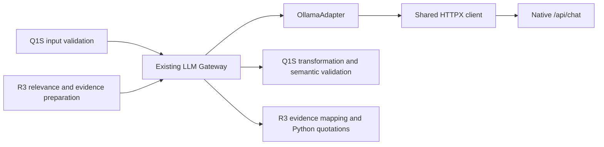

# Phase 18.5 architecture and integration

2026-11-26, Asia/Saigon. The existing Gateway now supports explicit experimental Ollama Native composition for frozen Q1S and R3. Implementation completion does not approve production activation. Phase 18 remains `IMPLEMENTED_PENDING_BACKUP_VALIDATION`.

Previously Q1S injected `OllamaIntentExtractor` with its own HTTP client and R3 injected `LocalRecommendationGenerator` with another client. Those paths remain available for historical runners. The integrated FastAPI lifespan constructs one Gateway, one `OllamaAdapter` and one startup-owned async HTTPX connection pool:



The adapter handles transport and native envelope validation. Gateway handles routing, structural schema validation, deadlines, attempts, quota, health and telemetry. Q1S retains extraction-to-public-output transformation; R3 retains fact-to-product mapping, authoritative metadata, source quotation assembly and safe fallback. No second Gateway, SDK, repair pass or semantic judge was added.

| Existing integration point | Native extension |
|---|---|
| `adapters/base.py`: `prepare`, `complete_once`, `aclose` | `adapters/ollama.py` implements the same interface and returns `AdapterResult`; dispatch hook runs once. |
| `config.py`: `Provider`, `RoutingConfig`, `load_gateway_config` | Adds native kind/mode, frozen seed/context/output options, endpoint policy, experimental evidence scope, digest and exact schema fingerprints. Existing artifact hash/expiry/approval/cost checks remain. |
| `registry.py`: `CAPABILITIES`, `routes_for`, `ineligibility` | Native capability; trusted R3 family plus canonical schema comparison and approved per-request fingerprint. |
| `gateway.py`, `failover.py`, `quota.py`, `health.py` | Reuses the existing execution loop and leases; native profile forbids failover, limits each task/route to one attempt and provider concurrency to one. |
| `schemas.py`, `telemetry.py`, `errors.py` | Internal provider/timing/digest/fingerprint attribution and fallback event. Public business schemas remain unchanged. |
| `experiment_factory.py` | Adds trusted internal flat extraction class and selection-family marker. No decoder converts fact indices into public recommendations. |
| `native_runtime.py`, `api/main.py` lifespan | Normal evidence-validating registry/loader; one native adapter for both consumers; no cloud adapter constructed. |

## Native profile and security

The sole endpoint/model/options source is the selected YAML, rather than new duplicate `OLLAMA_MODEL`/URL settings. The checked-in [template](../../config/llm_gateway_ollama_experimental.yaml) has all routes disabled/pending with unknown cost. The original `config/llm_gateway.yaml` is unchanged. Selecting the template alone cannot dispatch inference.

```dotenv
LLM_GATEWAY_ENABLED=true
LLM_GATEWAY_RUNTIME=ollama_experimental
LLM_GATEWAY_CONFIG_PATH=config/llm_gateway_ollama_experimental.yaml
LLM_GATEWAY_AUTO_FAILOVER=false
LLM_GATEWAY_MAX_ATTEMPTS_PER_TASK=1
LLM_GATEWAY_ATTEMPT_TIMEOUT_SECONDS=30
LLM_GATEWAY_OLLAMA_IDENTITY_TTL_SECONDS=300
LLM_GATEWAY_OLLAMA_APPROVED_ENDPOINTS=[]
```

These settings are an explicit disabled-template composition example. For supervised validation the harness creates an isolated copy with time-limited experimental test permission, real prior native evidence hashes, fresh model identity, passing offline report hash, exact schema fingerprints and options. It uses the same loader and eligibility checks. Its `approval: approved` records permission for that isolated integration test, never production semantic approval. Do not copy expired test approvals into production.

The local endpoint is `http://127.0.0.1:11434`; loopback HTTP requires an explicit port and no credential. Remote mode requires an exact operator-configured endpoint in `LLM_GATEWAY_OLLAMA_APPROVED_ENDPOINTS`, HTTPS on port 443, and `credential_env: OLLAMA_API_KEY`. For example the approved endpoint list would contain exactly `https://ollama.example.org` and the selected provider YAML would use that same string. No public tunnel or remote service was deployed. Embedded credentials, path additions, query/fragment additions, unapproved hosts and redirects are rejected. Existing cloud endpoint/credential allowlists are preserved. Owned clients disable environment proxies, redirects and HTTP transport retries; authentication is limited to the dedicated remote credential.

Both routes select `qwen2.5:1.5b-instruct-local`, expected digest `d010eb818583111cfafeb3523cc17802f85dcb7f4fe5e8ecdd4927dca40e3174`, temperature 0, seed 42, context 4096, stream false. Q1S reserves 512 output tokens and R3 reserves 256. `POST /api/chat` receives the caller's exact JSON Schema in `format`. No `/v1` endpoint is used.

## Schema and evidence binding

`phase8.intent.flat.v1` binds the frozen strict, extra-forbidden `ExtractedShoppingIntent`, including its original required fields. It does not replace `phase8.query.v1`.

`phase12.catalog-selection.v2` binds `selection_schema(supplied)` under stable family `r3.required-keys.v2`. Each request requires exactly its supplied `p1..pn` keys, strict integer arrays of 1–3 product-owned fact indices, valid per-product upper bounds and no duplicate indices or extra keys. The registry accepts only canonical factory schemas for 1, 3 or 5 products, with 1–13 facts per product, and then requires the exact SHA-256 schema fingerprint in route evidence. Approving one shape does not approve every shape. New real candidate/evidence shapes need their own evidence before use; ineligibility safely prevents dispatch.

The fingerprint is SHA-256 of UTF-8 `json.dumps(model.model_json_schema(), sort_keys=True)`, including default JSON whitespace. The narrow integration correction adds `uniqueItems` and a duplicate-index model validator to the existing R3 factory. Its previous business check already rejected duplicates; valid frozen selection semantics and prompts are preserved.

## Lifecycle, deadlines and failures

`build_native_gateway` creates one owned client unless a caller injects a shared client. Both consumers keep a reference to the same Gateway and allocate no separate transport. Consumer cleanup does not close the Gateway. Gateway shutdown closes the owned adapter/client once; injected clients remain caller-owned. Startup failure and normal shutdown use the existing lifespan cleanup. Historical direct runners retain their original ownership behavior.

The effective attempt deadline is bounded by the configured provider attempt timeout, remaining task time (query 30 seconds, recommendation 45 seconds), and remaining parent time. API 90 seconds and bot 95 seconds remain parent/client budgets, not additive allocations. HTTPX timeouts are also bounded by Gateway's outer async deadline. Cancellation propagates, quota/health leases release, and no native retry or cloud backup is possible. `max_in_flight=1` is process-local: use one worker for this prototype; multiple workers require separate global capacity design.

Malformed/truncated envelopes, wrong model, invalid usage/durations, duplicate JSON keys, non-finite JSON, invalid structured payloads and oversized responses fail typed validation. Requests use a conservative UTF-8 byte admission check plus reserved output/margin; the adapter caps serialized requests and streamed responses at 1,000,000 bytes. Reported prompt counts must also leave the reserved completion window. This may reject safe long inputs; it never silently trims requirements or evidence.

Q1S inference failure returns an invalid fail-closed result. R3 may return existing deterministic catalog fallback only after upstream/relevance guards pass. Parent deadline exhaustion and cancellation propagate instead of becoming fallback success. No-results, invalid input, clarification, unsupported intent and relevance failure stop before inference. The legacy downstream numeric-negation mismatch remains open for Phase 18.6.

## Identity, health, usage and telemetry

Startup uses native `GET /api/tags` to compare exactly one matching model tag and digest. Eligibility also requires the approved route digest/options/schema evidence and an unexpired verification cache. A mismatched/unreachable startup leaves identity unverified and requests fail closed. Cache TTL defaults to 300 seconds; stale identity blocks dispatch and readiness until explicit `verify_native_gateway` succeeds or the process restarts. There is no background polling. `/health` reports configuration eligibility, recent identity verification and transport cooldown separately; it does not issue inference or claim instantaneous availability from a cached tag check. Tag equality on a response alone does not prove digest identity, and this control-plane evidence is not cryptographic runtime attestation.

Native token counts map to nullable Gateway usage; total is their sum only when both counts are known. Durations convert nanoseconds to milliseconds. No monetary estimate is synthesized. Public legacy integer usage fields use zero only as schema defaults when unknown and include an explicit warning; Gateway records retain nulls. Failed responses preserve known usage, safe model attribution and valid timing where available. Malformed/unavailable metadata remains unknown.

Attempt events preserve IDs, task/schema/fingerprint, provider/route, requested/reported model, expected digest, attempt number, outcome/reason, latency, usage and native timings. Task summaries correlate attempts; R3 fallback emits a separate content-free fallback event. Existing `missing_usage_attempts` also counts absent reasoning/cost data, so it can be nonzero even when native input/output counts are present. Raw prompts/responses are excluded from production telemetry. Isolated validation artifacts intentionally retain raw outputs/evidence for audit and must remain separate from runtime telemetry.
