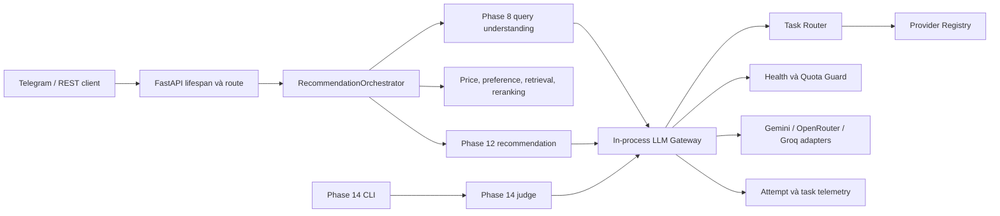

# Phase 18 V1 — Kiến trúc Centralized LLM Gateway

**T01 · 2026-11-20 (Asia/Saigon) · Đặc tả triển khai**

Phase 18 thêm Gateway chạy trong cùng process với ShopAssist, dùng cho query understanding, recommendation generation và Phase 14 judge. Một Gateway của ứng dụng quản lý các client, ưu tiên route, giới hạn outbound requests và telemetry. Các task tiếp tục sở hữu prompt, input/output schemas, quy tắc nghiệp vụ và cách kết thúc khi Gateway hết route. [Gateway contract](phase18_gateway_contract.md) · [Audit T00](phase18_preimplementation_audit.md)

## Hiện trạng đã đối chiếu

| Integration point | Contract và thay đổi tại ranh giới |
| --- | --- |
| Phase 8 | `QueryUnderstandingEngine.parse_query_async` kiểm query, dựng prompt, gọi `GeminiClient.generate_structured_async` bằng `QueryUnderstandingOutput` v1 và normalize kết quả theo catalog. T12 thay lời gọi inference bằng Gateway. API vẫn kiểm `is_valid` trước `needs_clarification`. [Query engine](../src/shopassist/llm/query_understanding.py) · [GeminiClient](../src/shopassist/llm/gemini_client.py) |
| Phase 12 | `RecommendationService.generate` nhận kết quả Phase 8/9/11, cắt Top-K, dựng evidence context/prompt, rồi lấy tuple payload/usage từ `BaseRecommendationProvider`. T11 tích hợp Gateway ở ranh giới tuple, sau đó tiếp tục validate product IDs/citations và merge catalog metadata. [Service](../src/shopassist/recommendation/core.py) · [Provider implementations](../src/shopassist/recommendation/provider.py) · [Groundedness](../src/shopassist/recommendation/validation.py) |
| Orchestrator | Điều phối từng stage, giữ price adapter, preference, TF-IDF/pgvector, RRF, reranking, enrichment và sessions. T13 truyền cùng request ID và parent deadline tới hai service. Provider can thiệp qua service injection. [Orchestrator](../src/shopassist/api/services/orchestrator.py) |
| FastAPI | Lifespan dựng services riêng, đóng Gemini và OpenRouter qua thuộc tính private. T13 dùng một Gateway trên event loop của app và giao việc đóng adapter/client cho Gateway. Route recommendation giữ timeout toàn pipeline và mapping HTTP 504. [Lifespan](../src/shopassist/api/main.py) · [Recommendation route](../src/shopassist/api/routes/recommendations.py) |
| Phase 14 | `run_llm_judge` hiện gọi wrapper Gemini sync với `LLMJudgeResponseSchema`. T14 cung cấp bridge sync tại CLI hoặc entry point sync. Phần đánh giá vẫn giữ rubric và result schema. CLI demo khi không yêu cầu live hoặc khi legacy client không khởi tạo được. Lỗi generation sau khi đã có live client hiện được propagate. [Judge](../src/shopassist/evaluation/phase14_judge.py) · [CLI](../scripts/run_phase14_evaluation.py) |
| Cấu hình | Checkout có `.env` với flag Gateway bật, failover bật, paid tắt, 2 attempts/task, 1/route, timeout 25s, deadlines 30s/45s, cooldown 60s và telemetry bật với prompt/response logging tắt. `LLM_GATEWAY_CONFIG_PATH` trỏ đến `config/llm_gateway.yaml`, hiện chưa tồn tại. `.env.example` chứa config legacy. Kế hoạch V1 được đọc từ bản đính kèm vì đường dẫn plan trong repo chưa tồn tại. Chỉ kiểm tra tên biến credential. Các giá trị credential được giữ kín. |

## Dependency boundaries

- **Gateway** quản lý request deadline, route traversal, admission, một outbound dispatch mỗi attempt, schema validation chung và attempt accounting. Gateway nhận prompt đã dựng và schema do caller đăng ký. Gateway package dùng Pydantic và adapter protocols, không import API, retrieval hoặc business service packages. Caller ánh xạ lỗi và quyết định fallback nghiệp vụ.
- **Task Router** nhận task/schema/profile từ request và trả về danh sách route theo thứ tự bất biến của YAML. **Provider Registry** liên kết route với provider profile, model, capability và trạng thái phê duyệt. Runtime health/admission được kiểm tra ngay trước mỗi dispatch, sau bước static routing.
- **Provider adapters** chuyển request sang wire format theo capability của route, lấy usage ngay khi có provider response và chuẩn hóa lỗi. HTTP 400 schema rejection là kết quả của attempt đã gửi. OpenRouter không gửi lại dưới `json_object` trong cùng route. Gemini dùng `attempts=1` và đường wrapper một lần gọi, Groq đặt SDK `max_retries=0`, HTTPX dùng transport không retry/redirect. Redirect, model discovery, kiểm giá, hedging và request sửa JSON đều nằm ngoài đường inference.

## Startup, shutdown và rollout

FastAPI bật Gateway qua một snapshot cấu hình bất biến lúc startup. Validate YAML và liên kết policy trước khi tạo client. Adapter tạo client async trên loop sở hữu, có thể lazy, và Gateway cùng instance được inject vào hai service, với một owner chịu trách nhiệm `aclose()`. Cleanup đặt trong `finally`/exit stack, chạy khi startup lỗi một phần, khi shutdown và khi init client dở dang. Khi shutdown, ngừng admission, chờ task trong giới hạn shutdown rồi cancel phần còn chạy, sau đó đóng client và flush telemetry trong thời gian giới hạn. `aclose()` idempotent. Orchestrator dùng dependency được inject, không sở hữu client. CLI sở hữu Gateway của phiên chạy và đóng trên cùng loop. Bridge sync chỉ dùng ở entry point sync. Dependency injection legacy và các wrapper sync tiếp tục dùng được trong chế độ rollback.

Readiness lấy snapshot nội bộ Gateway. Giữ top-level `HealthResponse`, component keys hiện tại, DB probe 5s và quy tắc HTTP 200/503. Các keys LLM tiếp tục biểu diễn trạng thái cấu hình bằng chuỗi, `configured (<provider>)` trỏ tới primary đã cấu hình trong chế độ Gateway. Cooldown/quota và route đang dùng được ghi nội bộ. Liveness giữ nguyên. Health và startup không gửi provider probes. [Health route](../src/shopassist/api/routes/health.py)

Flag `LLM_GATEWAY_ENABLED=false` chọn legacy tại startup, giữ nguyên `GEMINI_*`, `PHASE12_LLM_*` và CLI overrides trong mode đó. Flag mặc định `false` khi **không có biến**, để checkout cũ với `.env.example` khởi động theo đường hiện tại. Khi flag là `true`, cấu hình lỗi hoặc file YAML thiếu làm startup từ chối với lỗi đã redacted. Lỗi provider ở runtime đi theo task fallback. Không tự chuyển sang legacy giữa request. Rollback thực hiện bằng flag rồi restart. Cấu hình legacy có hiệu lực độc lập và giữ các giới hạn/behavior chi phí legacy. Điều kiện chạy live và chính sách được phép chi tiêu vẫn áp dụng cho rollout/rollback. Chạy T02–T16 với mocks. T17 chỉ mở đường live sau khi có authorization. [Cấu hình và activation contract](phase18_gateway_contract.md#cấu-hình-và-validation)

## Ràng buộc nghiệp vụ và tương thích

| Luồng | Kết quả nghiệp vụ phải giữ |
| --- | --- |
| Phase 8 | Kết quả Gemini hợp lệ qua schema v1 và normalization trước khi dùng làm constraints. Khi hết route, trả Phase 8 result invalid với hard constraints trống và diagnostic vận hành an toàn. API vẫn trả business status `INVALID_INPUT` theo mapping hiện tại và dừng trước retrieval. `CLARIFICATION_REQUIRED` dành cho output hợp lệ có semantic clarification. Lỗi provider không tạo constraints/clarification giả. |
| Phase 12 | Provider success qua `LLMRecommendationPayload` và GroundednessValidator. Khi hết route, service dùng fallback từ verified catalog candidates/evidence đã chuẩn bị. Lỗi xác thực grounding vẫn dùng hành vi validator hiện tại, độc lập với route failover. Model/provenance nội bộ dùng route trả payload. Deterministic fallback giữ trạng thái và không gán model cho nội dung catalog-based. |
| Phase 14 | Live không được yêu cầu thì giữ `OFFLINE_DEMONSTRATION` hiện có. Nếu chưa có route live đủ điều kiện trước dispatch, CLI có thể giữ hành vi demo với `LIVE_SKIPPED` trong run diagnostics. Nếu live đã dispatch và thất bại, CLI propagate lỗi đánh giá an toàn và không tạo rubric scores, `LIVE_API` artifact hoặc thay thế bằng demo. Hai trạng thái vận hành failure/skip chỉ nằm trong run diagnostics, không đổi `LLMJudgeResult`. Khi live thành công, ghi model/provider của route thắng. |
| API / Telegram | Giữ endpoints, alias, OpenAPI schemas, status, product IDs/citations, links/images, session semantics, `X-Request-ID`, numeric usage và các mapping 422/503/504 hiện hành. Không dùng `fallback_used` để biểu thị provider failover thành công. Tổng usage public chỉ phản ánh các stage results và giữ quy ước numeric/zero legacy. Attempt usage đầy đủ ở telemetry nội bộ. |
| Top-K | Baseline Phase 18 cung cấp `top_k=3` rõ ràng. `.env` hiện đặt `BOT_DEFAULT_TOP_K=3` và `PHASE12_TOP_K=3` cho bot/service gọi độc lập. Public request `RecommendationRequest.top_k` vắng mặt vẫn mặc định 5 và chấp nhận 1–20, giữ clamp của orchestrator. Biến `API_DEFAULT_TOP_K` hiện chưa được dùng để đặt giá trị mặc định của request. Gateway không nhận Top-K. [API schema](../src/shopassist/api/schemas.py) · [Bot handler](../src/shopassist/bot/handlers/messages.py) |

## CLI và evaluation migration

- `parse_user_query.py` và `evaluate_query_understanding.py` dùng chung engine. Các Phase 8 experiment runner giữ dry-run, cache, pacing, request/token ceilings. Chế độ Gateway khai báo variant/model bằng task profile trong YAML và đưa profile vào cache key. CLI chọn profile đã khai báo, không truyền provider/model thẳng. Profile riêng của experiment phải được cô lập khỏi runtime và được duyệt. Phase 8.2 reserve theo outbound dispatch và settle theo usage từng attempt, dùng cùng accounting event với telemetry. Cache key gắn với exact model, prompt và schema để ngăn tái sử dụng khác điều kiện.
- `evaluate_phase12.py` dùng service qua Gateway ở mode mới. Gateway mode yêu cầu flag live rõ ràng trước khi gọi provider. Legacy mode giữ hỗ trợ `--provider`/`--model`. `test_gemini_connection.py` giữ diagnostics model listing như một lệnh operator opt-in riêng, tách khỏi budget của inference. T14 phải gắn bảo vệ live rõ ràng cho lệnh diagnostics.
- Phase 14 dùng route/task riêng để baseline rubric không tự chuyển theo model Phase 8. Phase 13 AI-Silver tiếp tục giữ adapter evaluator tách biệt, slot phê duyệt, offline controls và benchmark freezes. Việc thay route chấm benchmark cần thay đổi phạm vi riêng. [Phase 8.2 runner](../src/shopassist/llm/experiments/phase82/runner.py) · [Phase 12 CLI](../scripts/evaluate_phase12.py) · [Phase 13 CLI](../scripts/run_phase13_ai_silver.py)

## Acceptance theo task triển khai

| Gate | Bằng chứng cần có |
| --- | --- |
| T02 | Parse fixture YAML v1 với secret ENV giả. Từ chối duplicate/unknown fields, endpoint hoặc cross-reference sai, attempt/deadline vô hiệu. Flag true + YAML thiếu lỗi an toàn. Xác minh flag false dùng legacy và process ENV ưu tiên dotenv. |
| T03–T04 | Typed request/response/error, Pydantic schema ID & version match, null usage, registry ordered routes, reject capability thiếu, backup disabled/unapproved, giá unknown hoặc vượt policy. |
| T05–T06 | Mock transport kiểm request wire và payload tương thích. Mỗi adapter tối đa một dispatch, bao gồm HTTP 400 OpenRouter và SDK fallback path. Lỗi, timeout, usage trước parse và async cleanup. |
| T07–T10 | Fake clock và mock transport xác minh 0/1/2 attempts, tối đa 1/route, primary success, 429/503/timeout, invalid credentials/JSON, quota/cooldown/recovery, deadline/cancellation, cost policy, failover attribution và record count. Kiểm cả concurrent reservation và race lúc hết deadline. |
| T11–T13 | Giữ Phase 12 catalog fallback/grounding/prompts, Phase 8 fail closed/schema v1, injection một owner, startup/shutdown lỗi từng phần, readiness không gọi LLM. API/Telegram mocked tests kiểm contract, HTTP/status mapping, Top-K và request tracing. |
| T14–T15 | CLI explicit live, Phase 8 experiment budget/cache, Phase 14 demo/skip/live failure, YAML precedence/rollback, redaction, endpoint policy, bounded telemetry. Fixture không có key thật hay mạng. |
| T16 | Chạy toàn suite offline với harness T00, gồm primary success, 429/503/timeout → backup, hai provider fail, auth, JSON/schema fail, missing usage, cooldown/quota, attempt cap, paid denial, cancellation và task fallback/API regressions. |
| T17–T18 | Sau authorization, chạy isolated validation cho candidate theo provider/model, endpoint, credential scope, max calls/tokens và cost ceiling đã được duyệt. Kiểm model, schema, usage và grounding rồi mới cập nhật evidence/approval và kiểm runtime failover qua route đã bật. Phase 12 backup phải được duyệt và bật để V1 `COMPLETE`. Nếu chưa đạt, dùng `IMPLEMENTED_PENDING_BACKUP_VALIDATION`. Handover gồm test evidence, config/switching/rollback runbook, telemetry và deferred issues. |
